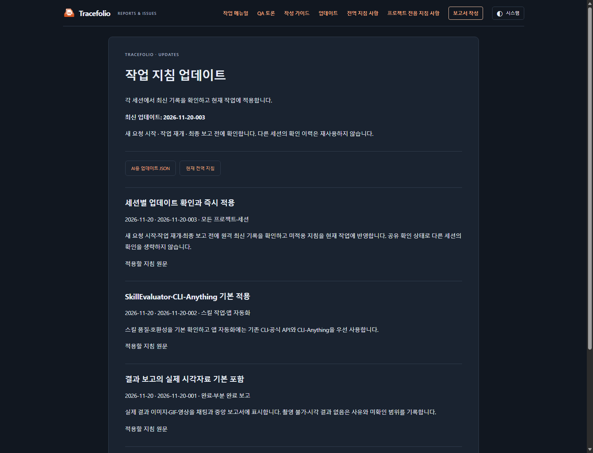

## 작업 결과

게시판 구현, 기존 공통 메뉴 연결, 최초 업데이트 3건 등록, 전역 설치본 동기화 완료.

## 변경 내용

### 적용 내용

guide/updates.json을 단일 기록 원본으로 게시판을 생성합니다. check-updates.mjs는 GitHub main을 캐시 없이 조회하고 세션별 --since ID 이후의 지침을 반환합니다. 원격 실패는 종료 코드 1과 로컬 기록을 반환하며 최신 확인을 성공으로 표시하지 않습니다. 다른 세션과 확인 상태를 공유하지 않습니다. 기존 미완성 변경은 보존했습니다.

## 검증

기존 사이트 빌드 성공. 실제 생성된 게시판을 별도 헤드리스 Edge로 렌더하고 제목·최신 ID·3개 기록·메뉴 가독성을 확인했습니다. 캡처는 2026-11-20 09:24 KST 현재 로컬 생성물이며 공개 화면 캡처는 아닙니다. 원격 CLI 확인은 푸시 후 수행합니다. 

## 남은 사항

이 규칙을 아직 읽지 않은 실행 중 세션의 강제 적용은 지원하지 않습니다. 원격 실패 시 최신 상태는 미확인으로 남깁니다. 프로젝트별 추가 지침을 게시할 때는 원문 경로 허용 목록을 확장해야 합니다. 스킬 신규·수정과 앱 harness 구축 작업이 아니므로 두 도구의 검사·생성 실행 대상은 없습니다.

## 작업 시간

- 제안 시간: 5~8분
- 실제로 완료된 시간: 2026-11-20 09:22:03~09:24:34 KST, 구현·빌드·화면 확인 2분 31초. 게시·배포 및 원격 확인 완료 시각은 채팅 최종 보고에 기록합니다.
- XERJ: 미사용 — rg와 로컬 원문으로 확인했습니다.
