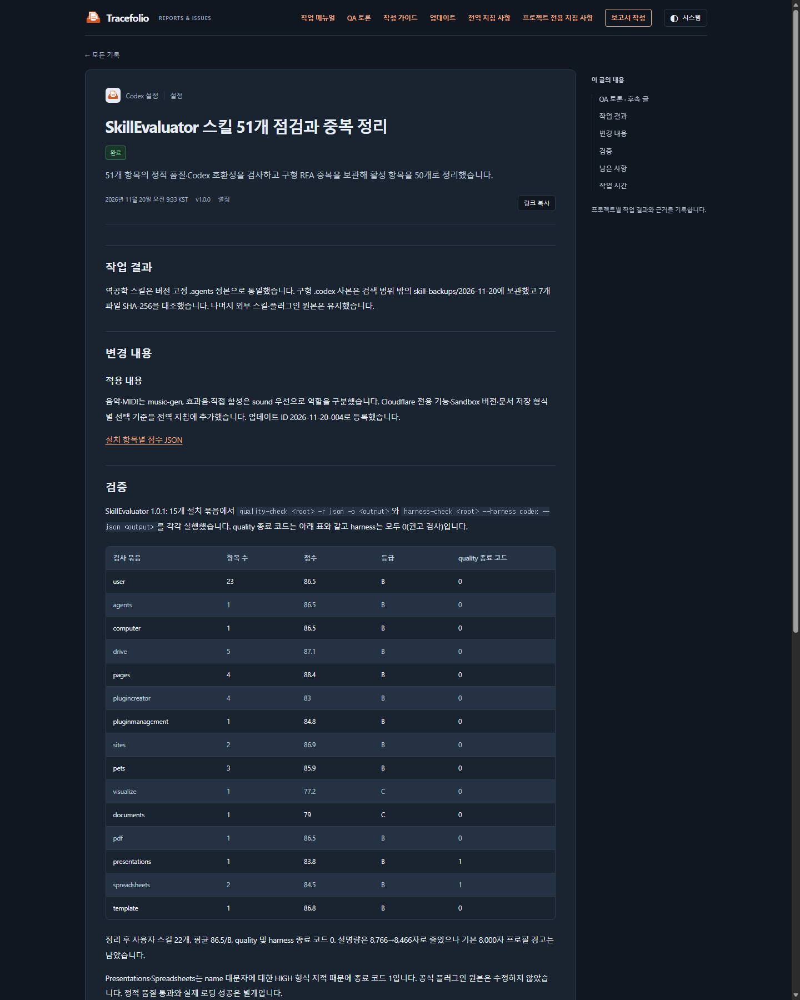

## 작업 결과

역공학 스킬은 버전 고정 .agents 정본으로 통일했습니다. 구형 .codex 사본은 검색 범위 밖의 skill-backups/2026-11-20에 보관했고 7개 파일 SHA-256을 대조했습니다. 나머지 외부 스킬·플러그인 원본은 유지했습니다.

## 변경 내용

### 적용 내용

음악·MIDI는 music-gen, 효과음·직접 합성은 sound 우선으로 역할을 구분했습니다. Cloudflare 전용 기능·Sandbox 버전·문서 저장 형식별 선택 기준을 전역 지침에 추가했습니다. 업데이트 ID 2026-11-20-004로 등록했습니다.

[설치 항목별 점수 JSON](../assets/2026-11-20-skill-audit.json)

## 검증

SkillEvaluator 1.0.1: 15개 설치 묶음에서 `quality-check <root> -r json -o <output>`와 `harness-check <root> --harness codex --json <output>`를 각각 실행했습니다. quality 종료 코드는 아래 표와 같고 harness는 모두 0(권고 검사)입니다.

| 검사 묶음 | 항목 수 | 점수 | 등급 | quality 종료 코드 |
|---|---:|---:|---|---:|
| user | 23 | 86.5 | B | 0 |
| agents | 1 | 86.5 | B | 0 |
| computer | 1 | 86.5 | B | 0 |
| drive | 5 | 87.1 | B | 0 |
| pages | 4 | 88.4 | B | 0 |
| plugincreator | 4 | 83 | B | 0 |
| pluginmanagement | 1 | 84.8 | B | 0 |
| sites | 2 | 86.9 | B | 0 |
| pets | 3 | 85.9 | B | 0 |
| visualize | 1 | 77.2 | C | 0 |
| documents | 1 | 79 | C | 0 |
| pdf | 1 | 86.5 | B | 0 |
| presentations | 1 | 83.8 | B | 1 |
| spreadsheets | 2 | 84.5 | B | 1 |
| template | 1 | 86.8 | B | 0 |

정리 후 사용자 스킬 22개, 평균 86.5/B, quality 및 harness 종료 코드 0. 설명량은 8,766→8,466자로 줄었으나 기본 8,000자 프로필 경고는 남았습니다.

Presentations·Spreadsheets는 name 대문자에 대한 HIGH 형식 지적 때문에 종료 코드 1입니다. 공식 플러그인 원본은 수정하지 않았습니다. 정적 품질 통과와 실제 로딩 성공은 별개입니다.

하위 점수: visualize 77.2, turnstile-spin 78.2, documents 79.0, starter-workflow 79.5. 점수만으로 제거하지 않았습니다.

2026-11-20 09:34 KST 로컬 보고서 실제 렌더 화면입니다. 검사 JSON을 표시한 결과이며 스킬 실행 UI나 실제 작업 효과 증거는 아닙니다.

## 남은 사항

전체 보안 스캔과 Tier 2 임베딩 중복 검사·Tier 3 실제 효과 평가는 미실행입니다. 중복 정리는 두 설치본의 실제 파일 차이에 근거했습니다. 호환성 프로필은 Codex CLI 0.166.0 기준이며 데스크톱 플러그인 로더 판정이 아닙니다. 스킬 목록 길이 경고의 실제 세션 영향은 미확인입니다. 캐시 내부 스킬을 포함한 설치 항목 수이며 현재 UI 노출 개수와 같다고 단정하지 않습니다.

## 작업 시간

- 제안 시간: 5~8분
- 실제로 완료된 시간: 2026-11-20 09:29:13 시작, 09:32:49 KST까지 검사·중복 보관·지침 반영 3분 36초. 보고서·캡처·푸시·배포 시간은 채팅 최종 보고에 기록합니다.
- XERJ: 미사용 — rg·로컬 설치 원문·SkillEvaluator JSON을 사용했습니다.
