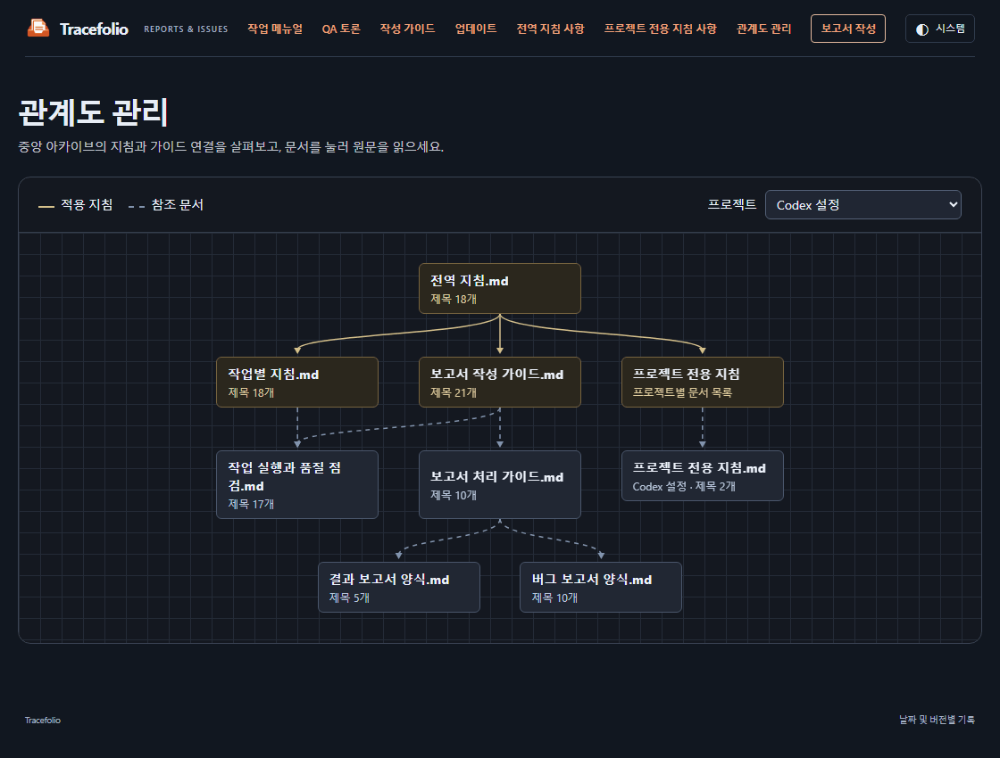

## 작업 결과

중앙 아카이브에 [관계도 관리](../../../guide/relationships.html)를 추가했습니다. 적용 지침은 실선, 참조는 점선으로 표시합니다.

## 변경 내용

### 적용 내용

- 전역 지침을 중심으로 작업별 지침, 작성·처리 가이드, 보고서 양식, 프로젝트 전용 지침을 연결했습니다. 공통 문서의 관계는 관계도 설정에서 관리하고 프로젝트 선택 목록은 아카이브 등록 목록에서 만듭니다.
- 문서 노드는 원본 Markdown을 렌더링한 팝업을 엽니다. 원문 링크와 문서 내부의 상대 링크도 사용할 수 있습니다.
- 검증된 전역·프로젝트 지침 추가 사항은 없습니다.

사용자는 첨부 이미지와 비슷한 관계도를 중앙 아카이브에 추가하고 Markdown을 누르면 팝업에서 읽을 수 있게 요청했습니다.
- 관계도와 팝업에 한글 문서명을 표시했습니다. 긴 문서에 접이식 목차를 제공하고 양식은 본문부터 표시합니다. 기존 파일 경로와 명령어·스키마 키는 그대로 사용합니다.

## 검증

- 중앙 아카이브 빌드에서 관계도 페이지 생성을 확인했습니다.
- Chrome 헤드리스에서 관계도 표시, 작성 가이드 팝업 본문과 상대 링크, 한글 문서명과 목차 이동, Esc 닫기와 초점 복귀, 프로젝트 전환과 전용 지침 팝업을 확인했습니다.
- 실제 브라우저 캡처에서 서로 다른 5개 프레임을 확인했습니다.

## 남은 사항

GitHub Pages 배포 및 공개 접근은 작성 시점에 미확인입니다.

## 작업 시간

- 제안 시간: 5~10분
- 실제로 완료된 시간: 구현 및 로컬 검증 7분 22초, 2026-11-21 03:21:46 KST
- XERJ: 미사용 — 로컬 아카이브 파일과 Chrome DevTools 캡처를 확인했습니다.
