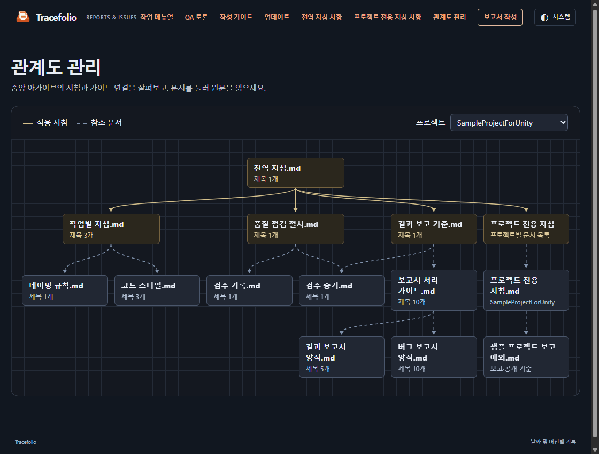

## 작업 결과

[관계도 관리](../../../guide/relationships.html)에서 네이밍·코드 스타일, 품질 점검 절차·검수 기록·검수 증거, 선택한 프로젝트의 보고 기준을 읽을 수 있습니다.

## 변경 내용

### 적용 내용

- 전역·작업별·보고 지침은 짧은 주제별 문서를 관계도의 읽기 경로로 구성했습니다. 전체 지침은 기존 위치에 두고 각 문서에서 연결했습니다.
- SampleProjectForUnity의 네이밍·함수·클래스·구조체·열거형·주석 원문을 대조해 코드 규칙을 정리했습니다.
- SampleProjectForUnity, CampGuardian, SNSManager, Fantasya, 중앙 아카이브의 보고·공개 조건을 분리했습니다. 별도 기준의 근거를 확인하지 못한 프로젝트는 확인 기록 없음으로 표시합니다.
- 실행 가능한 지침의 적용 범위는 원문 기준을 유지했습니다. 기술 규칙을 전역으로 확대할 근거는 없습니다.

사용자는 샘플 프로젝트의 컨벤션과 코드 스타일을 가져오고, QA 문서 및 큰 Markdown을 의미 단위로 나누며, 프로젝트별 보고 예외를 드러내 달라고 요청했습니다.

## 검증

- 공유 아카이브 빌드에서 관계도 생성을 확인했습니다.
- Chrome에서 한글 문서 표시, 팝업 간 이동, 코드 스타일 본문, 검수 기록 표, 샘플·소셜 프로젝트 예외와 별도 기준 미확인 표시를 확인했습니다.
- 실제 브라우저에서 촬영한 GIF에 서로 다른 5개 화면을 확인했습니다.

## 남은 사항

게시와 공개 접근 확인은 보고서 작성 시점에 미확인입니다.

## 작업 시간

- 제안 시간: 8~10분
- 실제로 완료된 시간: 구현 및 로컬 검증 4분 43초, 2026-11-21 03:28:50 KST
- XERJ: 미사용 — 샘플 저장소 Markdown 원문과 중앙 아카이브의 프로젝트 지침, 실제 Chrome 실행을 확인했습니다.
