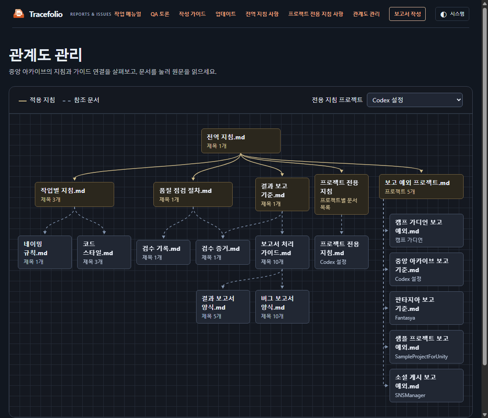

## 작업 결과

[관계도 관리](../../../guide/relationships.html)의 전역 지침 바로 아래에서 보고 예외 프로젝트 가지와 프로젝트별 문서를 열 수 있습니다.

## 변경 내용

### 적용 내용

- 이전 구현에서 보고 예외를 전용 지침 프로젝트 선택에 연결해 요청한 구조와 달랐습니다.
- 전역 지침에서 직접 이어지는 보고 예외 프로젝트 가지를 추가하고 다섯 프로젝트를 항상 표시합니다. 오른쪽에서 각 프로젝트 노드를 누르면 원래 보고 조건이 팝업으로 열립니다.
- 전용 지침 확인용 선택 메뉴는 해당 기능에만 적용됩니다. 확인되지 않은 예외는 목록에 넣지 않습니다.
- 프로젝트별 보고 규칙 자체는 기존 근거를 유지합니다.

## 검증

- 로컬 빌드 및 Chrome에서 전역 지침 연결, 예외 프로젝트 다섯 개 동시 표시, 목록에서 팝업 이동, 개별 프로젝트 노드 열기를 확인했습니다.
- 전용 지침 프로젝트를 바꿔도 예외 가지가 그대로 표시되는 것을 확인했습니다. 실제 화면으로 서로 다른 5개 GIF 프레임을 확인했습니다.

## 남은 사항

GitHub Pages 배포 및 공개 본문 접근은 작성 시점에 미확인입니다.

## 작업 시간

- 제안 시간: 4~6분
- 실제로 완료된 시간: 구현 및 로컬 검증 2분 24초, 2026-11-21 03:33:34 KST
- XERJ: 미사용 — 관계도 빌드와 Chrome 실제 동작을 확인했습니다.
