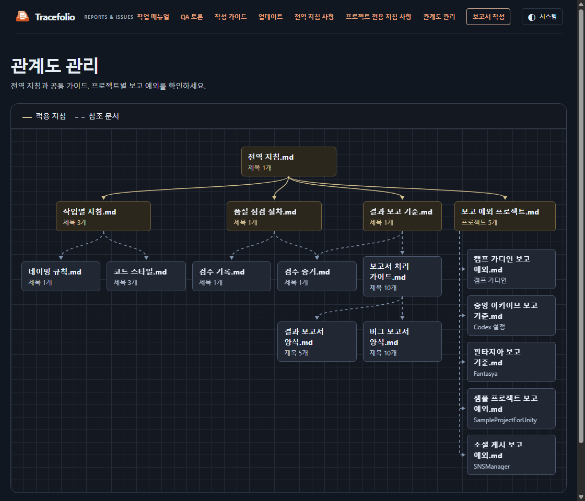

## 작업 결과

[관계도 관리](../../../guide/relationships.html)에서 전역 지침과 공통 가이드, 프로젝트별 보고 예외를 확인할 수 있습니다.

## 변경 내용

### 적용 내용

- 관계도에서 전용 지침 선택 메뉴, 전용 지침 노드와 팝업 데이터를 제거했습니다.
- 전역 지침의 주제 링크와 그래프 열을 전역 관리 범위에 맞췄습니다.
- 보고 예외는 전역 지침 아래 직접 연결된 다섯 프로젝트의 문서로 제공합니다.

## 검증

- 로컬 빌드를 확인했습니다. Chrome에서 프로젝트 메뉴·노드·미리보기 데이터 제거, 전역 지침과 보고 예외 팝업 이동, 예외 프로젝트 다섯 개 표시를 확인했습니다.
- 실제 화면을 담은 GIF의 서로 다른 세 프레임을 확인했습니다.

## 남은 사항

GitHub Pages 배포와 공개 본문 접근은 작성 시점에 미확인입니다.

## 작업 시간

- 제안 시간: 3~5분
- 실제로 완료된 시간: 구현과 로컬 검증 1분 37초, 2026-11-21 03:36:28 KST
- XERJ: 미사용 — 아카이브 빌드와 실제 Chrome 화면을 확인했습니다.
