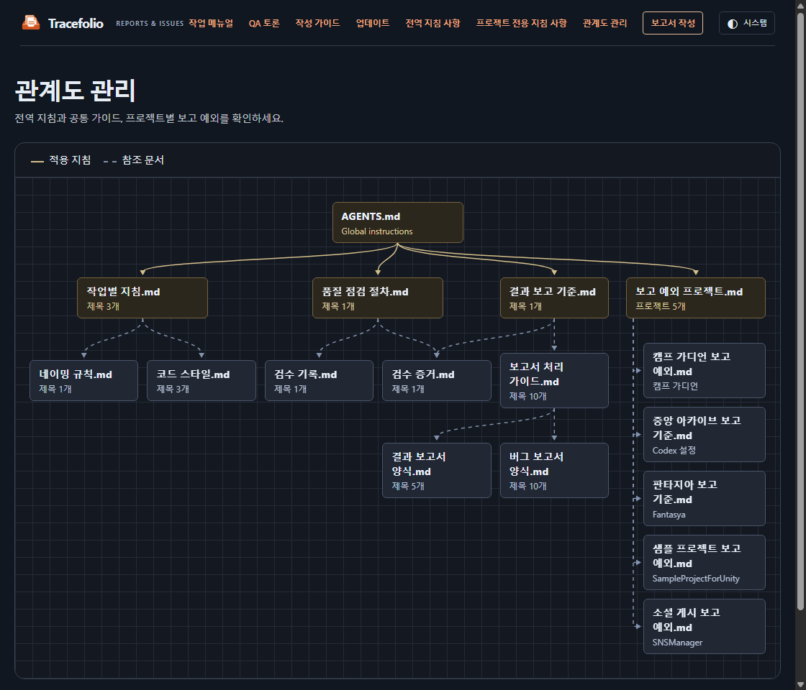

## 작업 결과

[전역 관계도](https://mdj0126.github.io/codex-config/guide/relationships.html)에서 루트 AGENTS.md의 영어 지침과 Markdown 원문 링크를 열 수 있습니다.

## 변경 내용

### 적용 내용

이전 작업에서는 영어 AGENTS.md만 변경해 기존 관계도 시작점이 그대로 남았습니다. 이번에 관계도 빌드를 실제 저장소 루트 파일에 연결했습니다.

## 검증

빌드 및 Chrome에서 최상단 AGENTS.md, 팝업의 Codex Global Instructions 본문, GitHub 원문 링크를 확인했고 실제 화면 두 프레임을 확인했습니다.

## 남은 사항

작성 시점의 새 Pages 배포는 미확인입니다.

## 작업 시간

- 제안 시간: 5~8분
- 실제로 완료된 시간: 3분 5초, 04:03:29 KST 기준
- XERJ: 미사용 — 실제 Markdown 원문, 생성한 HTML과 Chrome 동작을 확인했습니다.
