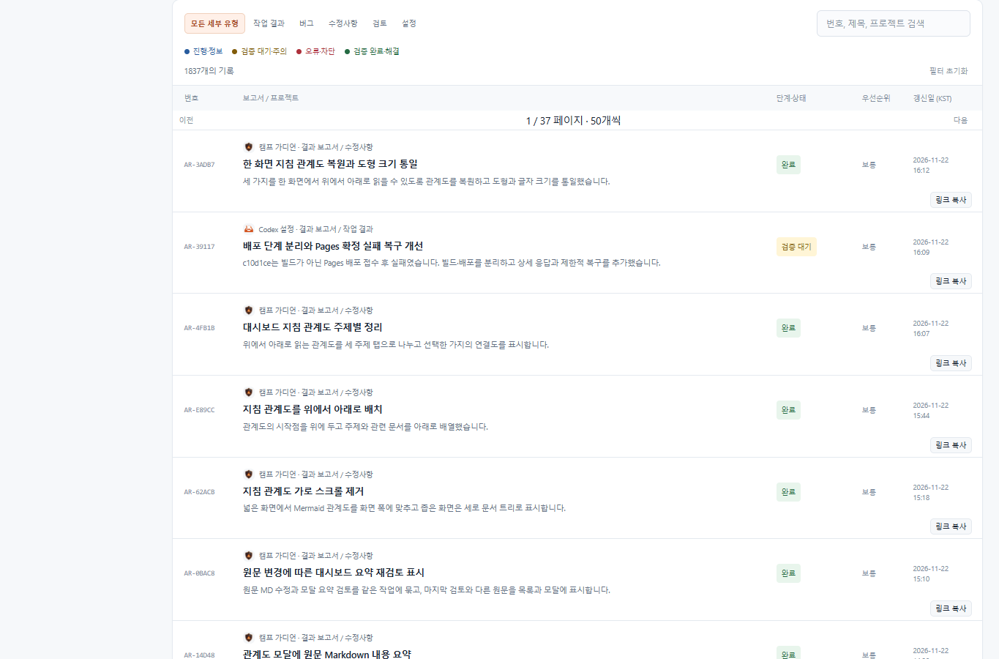

## 작업 결과

공개 메인 기준 초기 HTML 약 3.14MB·목록 1837개·DOM 26425개를 확인했습니다. 개선 패키지는 HTML 98630바이트·행 50개·DOM 1411개입니다. 전체 자료 검색·집계와 다음 페이지 이동은 유지됩니다. 초기 조회와 게시가 누적 자료 전체 DOM에 비례하는 구조를 개선했습니다. 승인 후 PR #4를 병합했고 실제 main 빌드·성능 예산·Pages 배포·공개 파일 검증이 성공했습니다.

## 변경 내용

### 적용 내용

전체 목록 데이터는 별도 JSON으로 전달하고 표시 행만 50개씩 렌더링합니다. JSON 주소에 내용 해시를 붙여 오래된 목록 캐시를 방지합니다. Markdown 파서·렌더러 해시 기반 캐시와 변경 없는 HTML 쓰기 생략, CI 캐시 재사용을 추가했습니다. 공개 페이지 링크를 따라 필요한 파일만 복사하고 원본은 보존합니다. sitemap으로 과거 글 탐색 경로를 유지합니다. 초기 HTML·목록 데이터·DOM 행 수·패키지 한도와 증가량을 게시 전 자동 검사하며 빌드 시간과 경고를 Actions 요약에 남깁니다. AGENTS와 프로젝트 지침·업데이트 2026-11-22-002를 함께 반영하고 설치본 SHA-256 일치를 확인했습니다.

## 검증

최신 원격 소스 검증 사본에서 2489개 보고서·81486개 링크 검사 통과. 빌드 기준 11498ms, 캐시 적용 후 8822ms(2489 hits)로 약 23% 단축. 공개 후보 1676398433바이트에서 개선 패키지 약 1627186823바이트로 감소하며 미참조 1052개·47387978바이트 제외. 실제 headless Chrome에서 검색·전체 집계·2/37 페이지 이동과 패키지 내 누락 리소스/JS 오류 0건 확인. 로컬 단일 측정 LCP 약 512ms·검색-표시 44ms이며 INP와 실사용 Core Web Vitals는 미측정입니다. 모든 수치는 16시대 사본 기준으로 이후 보고서 추가에 따라 달라집니다. 실제 패키지 화면과 동작을 2026-11-22 16:33경 촬영했습니다.

 최종 지침·보고서 포함 빌드는 21000ms, 2489 hits/1 miss였으며 최초 8.8초 결과가 매번 보장되는 것은 아닙니다. 최종 HTML 102092바이트·패키지 1627940864바이트, 성능 예산 통과(기존 미디어 1GiB 초과 경고 유지)를 확인했습니다. 23:46 KST 공개 사이트 실측: HTML 103154바이트, DOM 1411개, 50행, LCP 756ms(단일 데스크톱 실험), 검색-표시 55ms, 2/37페이지 이동, JS/리소스 오류 0건. 실제 GitHub build 4447ms·package 11791ms. 공개 보고서 HTTP 200, PNG/GIF 모두 HTTP 200·정확한 Content-Type·로컬 원본 SHA-256 일치. 실행 45034005099 성공.

## 남은 사항

연결된 과거 GIF·영상이 대부분이라 약 1.63GB의 누적 미디어는 남습니다. 기존 주소와 원본을 지키는 별도 미디어 아카이브 계층 설계가 필요합니다. 이를 해결했다고 보고하지 않습니다. 게시 예산은 프로젝트 운영 기준이며 1GiB 초과 경고를 유지하고 초과분을 숨기지 않습니다. 실제 공개 배포와 미디어 검증은 완료했습니다. web-perf의 DevTools MCP는 없어 해당 절차를 중단하고 공식 Playwright 런타임으로 실측했습니다. SkillEvaluator 자동 평가 비해당, CLI-Anything 새 harness 없이 기존 SDK 재사용. 검증 사본과 기존 소스 백업은 .performance-work에 보존했습니다. 사용자 다른 작업은 커밋하지 않습니다.

## 작업 시간

- 제안 시간: 최초 20~30분, 23:01 재개 시 남은 작업 10~15분
- 실제로 완료된 시간: 2026-11-22 16:19:33~16:33:13 KST 약 13분40초 구현·측정 후 중단. 23:01:30 KST 재개. 중단 대기 시간은 작업 소요에서 제외하며 푸시·배포·최종 실측은 채팅에 따로 기록합니다. 승인 후 게시 작업 23:37:12~23:46:49 KST 약 9분37초. 누적 실작업 약 29분18초이며 사용자 중단·승인 대기는 제외했습니다. 최신 지침 2026-11-22-004 확인.
- XERJ: 미사용 — 코드 검색 근거가 제공되지 않았습니다.
