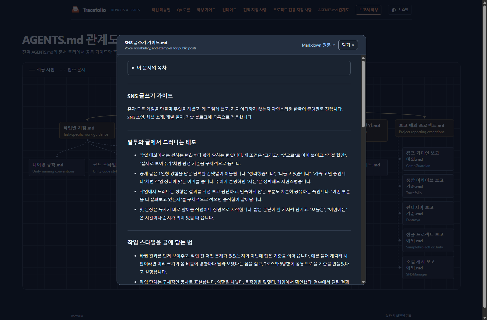

## 작업 결과

관계도에서 작업별 지침 아래의 SNS 글쓰기 가이드를 열 수 있습니다.

## 변경 내용

### 적용 내용

말투, 작업 스타일, 자주 쓰는 표현과 대체어, 게시글 예문을 중앙 Markdown에 통합했습니다. 공개 글 작성 시 중앙 원본과 최근 확정 게시글을 참고하도록 전역 지침을 변경했습니다.

## 검증

로컬 아카이브 빌드 14.04초. 관계도 초기 HTML 75,227바이트, 노드 19개, 가이드 추가에 따른 관계도 HTML 증가 9,382바이트. Markdown 원본 6,510바이트. 헤드리스 Chrome에서 카드 열기와 본문 표시를 확인했습니다. 설치 및 저장소 지침 SHA-256 일치.

## 남은 사항

등록 시점의 GitHub Pages 배포와 공개 관계도 확인은 미확인입니다.

## 작업 시간

- 제안 시간: 약 5분
- 실제로 완료된 시간: 2026-11-22 23:15:34 시작, 23:19 KST 기준 약 3분 30초.
- XERJ: 미사용 — 로컬 빌드 및 헤드리스 Chrome 확인
