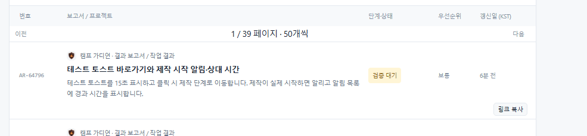

## 작업 결과

보고서 목록·상세, 작업 메뉴얼·QA 이력, 토론, 활동 기록, 업데이트 및 관련 보고서 선택에서 상대 시간 표기를 적용했습니다.

## 변경 내용

### 적용 내용

공통 포매터로 ‘방금 전’, 분·시간·일·주·개월·년 단위를 표시합니다. 날짜 정밀도만 기록된 항목의 툴팁에는 시각 미기록을 표시합니다. 달력의 월 구분과 날짜 필터용 값은 기존 기준을 사용합니다.

## 검증

Chromium에서 밝은 테마의 보고서 목록과 상세, 메뉴얼, 토론, 업데이트 페이지의 표기와 마우스 오버, 목록 검색·페이지 이동, 좁은 화면의 어두운 테마를 확인했습니다. 로컬 빌드 16.5초, 초기 HTML 106,069바이트, 목록 데이터 1,292,790바이트, 초기 50행, 로컬 패키지 1,684,741,422바이트로 성능 한도를 통과했습니다. 이 패키지는 보관 미디어 캐시 없이 측정했습니다.

## 남은 사항

공개 Pages 배포·접근, 운영 패키지 증가량은 미확인입니다. 로컬 전체 검증은 미디어 보관함 생성에 필요한 배포용 캐시가 없어 중단했습니다.

## 작업 시간

- 제안 시간: 약 7분, 2026-11-23 17:52 KST 시작
- 실제로 완료된 시간: 로컬 기능 검증 2026-11-23 17:57 KST 완료, 약 5분
- XERJ: 미사용 — 코드 검색 근거가 제공되지 않았습니다.
