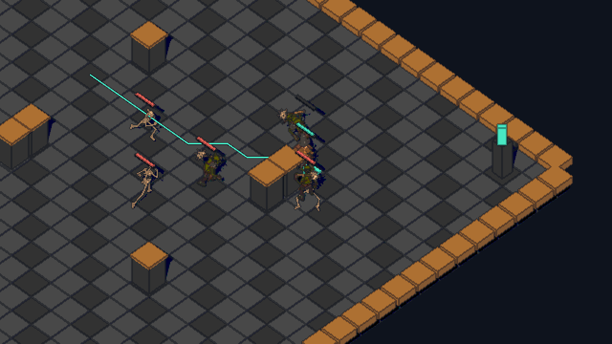
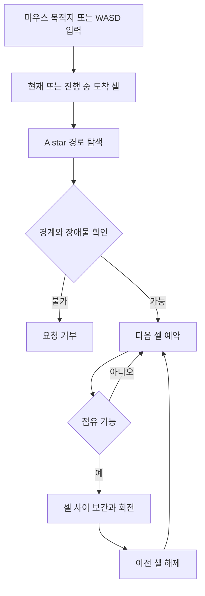

## 작업 결과

기존 정적 씬에는 이동이 없었습니다. 이제 마우스로 목적지를 지정하면 8방향 경로를 따라 셀 사이를 보간합니다. WASD도 같은 이동 경로를 사용합니다.





[프로젝트 소유 전체 소스](../assets/combat-20261116/source-index.md) · [실제 실행 수치](../assets/combat-20261116/combat-play-evidence.txt) · [외부 원본 해시](../assets/combat-20261116/combat-vendor-hashes.json)

## 변경 내용

### 적용 내용

CombatGrid.FindPath는 경계·장애물을 검사하고 대각선 이동 시 인접한 두 직교 셀도 검사합니다. 실패하면 빈 경로를 반환합니다. 다음은 실제 핵심 메서드 전체입니다.

```csharp
public List<Vector2Int> FindPath(Vector2Int start, Vector2Int goal)
        {
            var result = new List<Vector2Int>();
            if (!IsWalkable(goal) || start == goal)
            {
                return result;
            }
            var open = new List<Vector2Int> { start };
            var cost = new Dictionary<Vector2Int, float> { [start] = 0 };
            var parents = new Dictionary<Vector2Int, Vector2Int>();
            var closed = new HashSet<Vector2Int>();
            while (open.Count > 0)
            {
                Vector2Int current = open[0];
                foreach (Vector2Int candidate in open)
                {
                    if (cost[candidate] + Vector2Int.Distance(candidate, goal) < cost[current] + Vector2Int.Distance(current, goal))
                    {
                        current = candidate;
                    }
                }
                open.Remove(current);
                if (current == goal)
                {
                    while (current != start)
                    {
                        result.Add(current);
                        current = parents[current];
                    }
                    result.Reverse();
                    return result;
                }
                closed.Add(current);
                for (int x = -1; x <= 1; x++)
                {
                    for (int y = -1; y <= 1; y++)
                    {
                        Vector2Int next = current + new Vector2Int(x, y);
                        if ((x == 0 && y == 0) || !IsWalkable(next) || closed.Contains(next))
                        {
                            continue;
                        }
                        if (x != 0 && y != 0 && (!IsWalkable(current + new Vector2Int(x, 0)) || !IsWalkable(current + new Vector2Int(0, y))))
                        {
                            continue;
                        }
                        float score = cost[current] + (x != 0 && y != 0 ? 1.41421356f : 1f);
                        if (!cost.TryGetValue(next, out float previous) || score < previous)
                        {
                            cost[next] = score;
                            parents[next] = current;
                            if (!open.Contains(next))
                            {
                                open.Add(next);
                            }
                        }
                    }
                }
            }
            return result;
        }
```

## 검증

실제 이동을 처리하는 GridMotor 전체입니다. 목적지 변경 시 진행 중 세그먼트는 마친 뒤 새 경로를 적용합니다.

```csharp
using System.Collections.Generic;
using UnityEngine;

namespace DotAction
{
    /// <summary>
    /// 셀 사이를 부드럽게 이동하며 출발·도착 셀을 예약해 겹침을 막는다.
    /// </summary>
    public sealed class GridMotor : MonoBehaviour
    {
        public CombatGrid grid;
        public float speed = 4;
        public Transform visual;
        public Animator animator;
        public bool IsMoving { get; private set; }
        public int CompletedSteps { get; private set; }
        private List<Vector2Int> _path = new();
        private Vector2Int _cell;
        private Vector2Int _next;
        private bool _isInSegment;

        private void Start()
        {
            if (grid == null)
            {
                grid = FindFirstObjectByType<CombatGrid>();
            }
            _cell = CombatGrid.Cell(transform.position);
            transform.position = CombatGrid.World(_cell);
            grid.TryOccupy(_cell, this);
        }

        private void Update()
        {
            if (!_isInSegment && _path.Count > 0 && grid.TryOccupy(_path[0], this))
            {
                _next = _path[0];
                _path.RemoveAt(0);
                _isInSegment = true;
            }
            IsMoving = _isInSegment;
            if (animator != null)
            {
                animator.SetBool("Moving", IsMoving);
            }
            if (!_isInSegment)
            {
                return;
            }
            Vector3 target = CombatGrid.World(_next);
            Vector3 direction = target - transform.position;
            if (direction.sqrMagnitude > 0.0001f && visual != null)
            {
                visual.rotation = Quaternion.RotateTowards(visual.rotation, Quaternion.LookRotation(direction), 720 * Time.deltaTime);
            }
            transform.position = Vector3.MoveTowards(transform.position, target, speed * Time.deltaTime);
            if ((transform.position - target).sqrMagnitude < 0.00001f)
            {
                grid.Release(_cell, this);
                _cell = _next;
                _isInSegment = false;
                CompletedSteps++;
            }
        }

        private void OnDisable()
        {
            if (grid != null)
            {
                grid.Release(_cell, this);
                if (_isInSegment)
                {
                    grid.Release(_next, this);
                }
            }
            if (animator != null)
            {
                animator.SetBool("Moving", false);
            }
        }

        public bool MoveTo(Vector2Int destination)
        {
            Vector2Int start = _isInSegment ? _next : _cell;
            if (!grid.IsWalkable(destination))
            {
                return false;
            }
            List<Vector2Int> path = grid.FindPath(start, destination);
            if (path.Count == 0 && destination != start)
            {
                return false;
            }
            _path = path;
            return true;
        }
    }
}

```

실제 Play Mode: elapsed=45.79; steps=54; shots=60; kills=24; wave=3; health=84; finished=True; errors=0

## 남은 사항

플레이어 빌드·게임 저장소 커밋·푸시는 하지 않았습니다. 프로젝트 루트는 Git 저장소가 아닙니다. 마우스·WASD의 사람이 직접 조작한 체감과 다른 해상도·플랫폼 성능은 미확인입니다. 슬롯·증강·군중 교착 회피는 이번 범위에 포함하지 않았습니다. 자동 테스트는 요청하지 않으셔서 작성·실행하지 않았습니다. 화면 HUD와 승패 문구는 사용자 요청에 따라 제거했고 월드 체력바만 표시합니다. 추가 승패 연출은 미구현입니다.

## 작업 시간

- 제안 시간: 최초 35~50분. 추가 PC 근접 뷰·미니멀 UI 요청과 공개 확인으로 5~8분 추가 예상을 안내했습니다.
- 실제로 완료된 시간: 시작 2026-11-16 17:22:25 KST; 구현·실행·원본 반영 완료 및 기록 2026-11-16 18:14:21 KST; 실측 51분 56초. 보고서 공개 배포 대기는 이후 채팅에서 별도로 기록합니다.
- XERJ: 미사용 — 사용자 지침에 따라 연결 확인도 수행하지 않았습니다.
