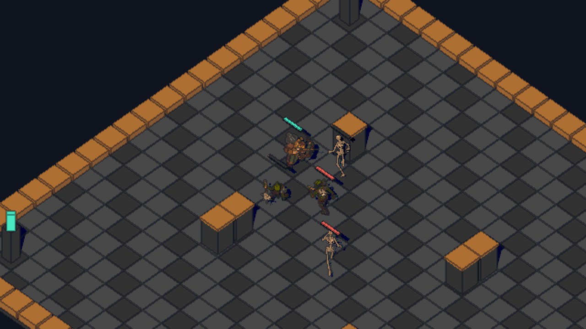
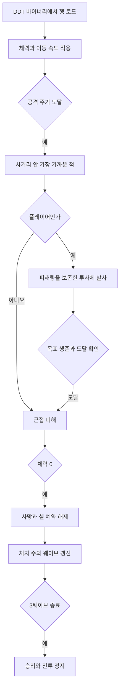

## 작업 결과

DDT의 CombatStats.xlsx에 레인저·고블린·스켈레톤의 체력·속도·피해량·사거리·공격 주기를 저장했습니다. 런타임은 DDT가 생성한 타입과 바이너리에서 값을 읽습니다. 사거리 안에서 가장 가까운 적을 자동 공격하고 6·8·10마리의 3웨이브를 처리합니다.





웨이브 생성 메서드 전체:

```csharp
private void SpawnWave()
        {
            Wave++;
            _remaining = 4 + Wave * 2;
            for (int i = 0; i < _remaining; i++)
            {
                float angle = (i * 360f / _remaining + Wave * 23) * Mathf.Deg2Rad;
                Vector2Int cell = new Vector2Int(Mathf.RoundToInt(Mathf.Cos(angle) * 9), Mathf.RoundToInt(Mathf.Sin(angle) * 9));
                CombatActor enemy = Instantiate(enemyPrefabs[i % enemyPrefabs.Length], CombatGrid.World(cell), Quaternion.identity);
                enemy.motor.grid = player.motor.grid;
            }
            Debug.Log($"DOTACTION_WAVE: {Wave}; enemies={_remaining}");
        }
```

[프로젝트 소유 전체 소스](../assets/combat-20261116/source-index.md) · [실제 실행 수치](../assets/combat-20261116/combat-play-evidence.txt) · [외부 원본 해시](../assets/combat-20261116/combat-vendor-hashes.json)

## 변경 내용

### 적용 내용

CombatActor.Update의 실제 전체 구현입니다. 적은 플레이어 셀 대신 점유 가능한 인접 셀을 추적하며, 발사 후 쿨다운과 공격 애니메이션을 연결합니다.

```csharp
private void Update()
        {
            if (!IsAlive)
            {
                return;
            }
            if (!isPlayer)
            {
                if (_player == null)
                {
                    _player = Actors.Find(actor => actor.isPlayer && actor.IsAlive);
                }
                if (_player == null || !_player.IsAlive)
                {
                    motor.enabled = false;
                    return;
                }
                if (Time.time >= _nextPath)
                {
                    _nextPath = Time.time + 0.45f;
                    Vector2Int playerCell = CombatGrid.Cell(_player.transform.position);
                    // 적은 플레이어 셀을 예약하지 않고 인접한 공격 위치로 이동한다.
                    Vector2Int best = CombatGrid.Cell(transform.position);
                    float distance = float.MaxValue;
                    for (int x = -1; x <= 1; x++)
                    {
                        for (int y = -1; y <= 1; y++)
                        {
                            Vector2Int candidate = playerCell + new Vector2Int(x, y);
                            float score = Vector3.SqrMagnitude(CombatGrid.World(candidate) - transform.position);
                            if ((x != 0 || y != 0) && motor.grid.CanOccupy(candidate, motor) && score < distance)
                            {
                                best = candidate;
                                distance = score;
                            }
                        }
                    }
                    motor.MoveTo(best);
                }
            }
            if (Time.time < _nextAttack)
            {
                return;
            }
            CombatActor target = FindNearestTarget();
            if (target == null)
            {
                return;
            }
            _nextAttack = Time.time + Stats.Cooldown;
            ShotsFired++;
            if (!motor.IsMoving && motor.visual != null)
            {
                Vector3 direction = target.transform.position - transform.position;
                if (direction.sqrMagnitude > .001f)
                {
                    motor.visual.rotation = Quaternion.LookRotation(direction);
                }
            }
            animator.SetTrigger("Attack");
            if (isPlayer)
            {
                ArcBolt bolt = Instantiate(boltPrefab, transform.position + Vector3.up * 0.8f, Quaternion.identity);
                bolt.Launch(target, Stats.Damage);
            }
            else
            {
                target.TakeDamage(Stats.Damage);
            }
        }
```

## 검증

실제 Play Mode: elapsed=45.79; steps=54; shots=60; kills=24; wave=3; health=84; finished=True; errors=0

체력·사망 처리 전체:

```csharp
public void TakeDamage(float damage)
        {
            if (!IsAlive)
            {
                return;
            }
            Health = Mathf.Max(0, Health - damage);
            healthFill.localScale = new Vector3(Health / Stats.Health, 1, 1);
            if (Health > 0)
            {
                return;
            }
            animator.SetTrigger("Die");
            motor.enabled = false;
            CombatSession session = FindFirstObjectByType<CombatSession>();
            session.NotifyDeath(this);
            if (!isPlayer)
            {
                Destroy(gameObject, 2);
            }
        }
```

투사체 실행 전체:

```csharp
private void Update()
        {
            if (_target == null || !_target.IsAlive || Time.time > _expires)
            {
                Destroy(gameObject);
                return;
            }
            Vector3 target = _target.transform.position + Vector3.up * 0.8f;
            Vector3 direction = target - transform.position;
            if (direction.sqrMagnitude > 0.001f)
            {
                transform.rotation = Quaternion.LookRotation(direction);
            }
            transform.position = Vector3.MoveTowards(transform.position, target, speed * Time.deltaTime);
            if ((transform.position - target).sqrMagnitude < 0.04f)
            {
                _target.TakeDamage(_damage);
                Destroy(gameObject);
            }
        }
```

로드한 DDT 수치는 소스 하드코딩 대체값 없이 적용됩니다. 생성 코드와 바이너리는 공식 TableCreator API로 만들었습니다.

## 남은 사항

플레이어 빌드·게임 저장소 커밋·푸시는 하지 않았습니다. 프로젝트 루트는 Git 저장소가 아닙니다. 마우스·WASD의 사람이 직접 조작한 체감과 다른 해상도·플랫폼 성능은 미확인입니다. 슬롯·증강·군중 교착 회피는 이번 범위에 포함하지 않았습니다. 자동 테스트는 요청하지 않으셔서 작성·실행하지 않았습니다. 화면 HUD와 승패 문구는 사용자 요청에 따라 제거했고 월드 체력바만 표시합니다. 추가 승패 연출은 미구현입니다.

## 작업 시간

- 제안 시간: 최초 35~50분. 추가 PC 근접 뷰·미니멀 UI 요청과 공개 확인으로 5~8분 추가 예상을 안내했습니다.
- 실제로 완료된 시간: 시작 2026-11-16 17:22:25 KST; 구현·실행·원본 반영 완료 및 기록 2026-11-16 18:14:21 KST; 실측 51분 56초. 보고서 공개 배포 대기는 이후 채팅에서 별도로 기록합니다.
- XERJ: 미사용 — 사용자 지침에 따라 연결 확인도 수행하지 않았습니다.
