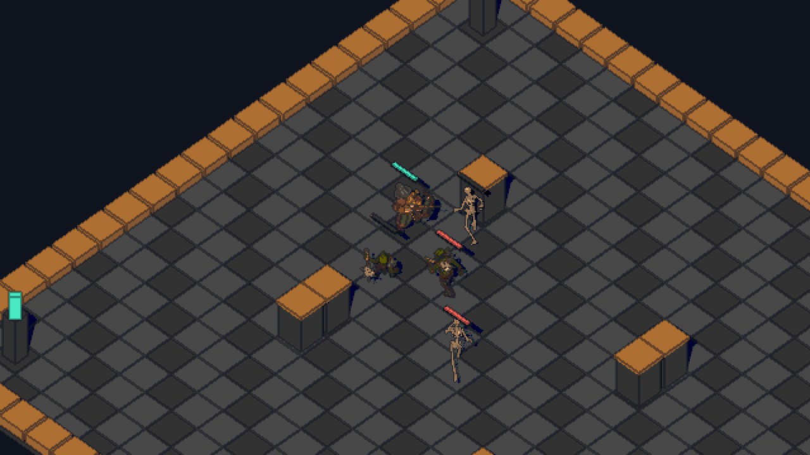
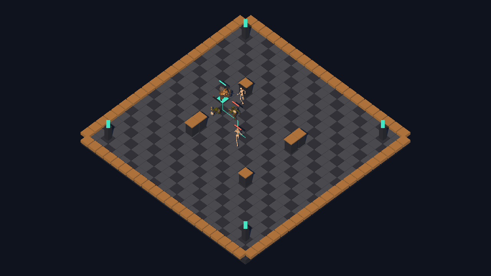
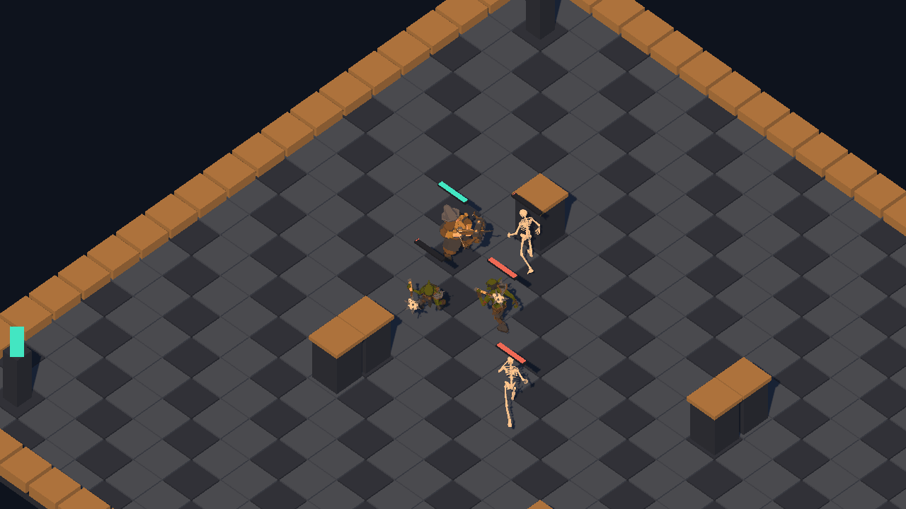
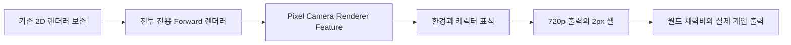
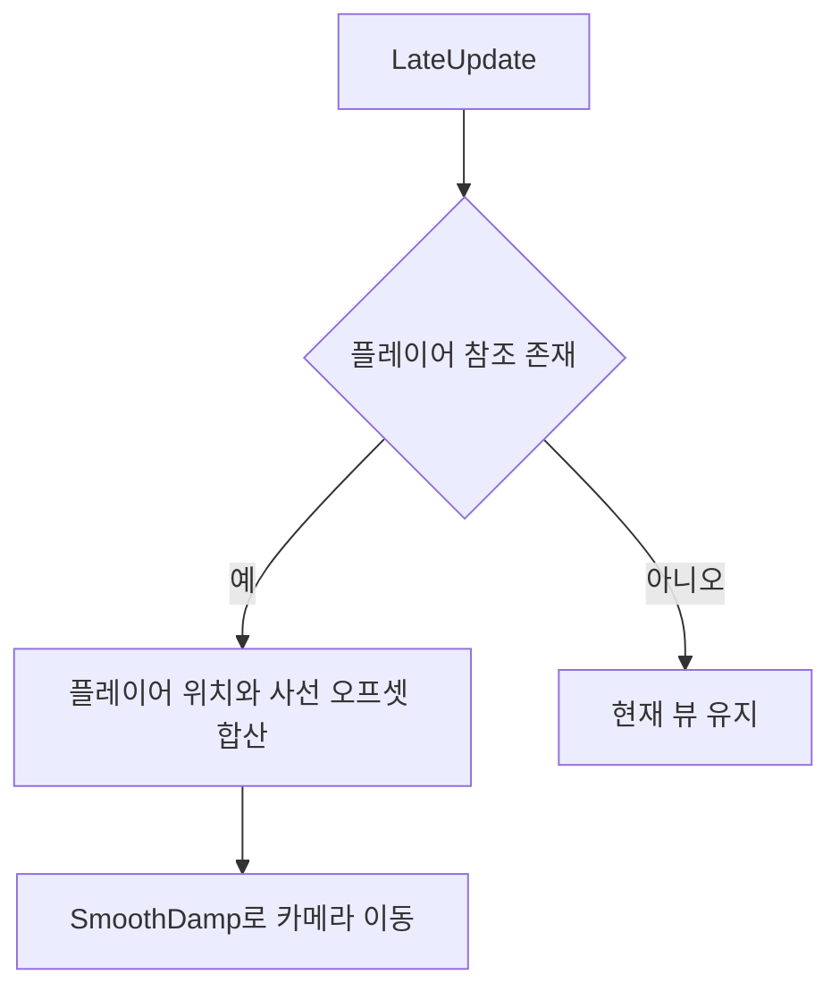

## 작업 결과



Pixel Camera·DDT·Low Poly Animated Fantasy Creatures를 도입했습니다. 왼쪽 클릭·누르기와 WASD로 격자 이동하고 가까운 적에게 자동 투사체를 발사합니다. R로 재시작합니다.

추가 요청에 따라 전체 경기장을 보여주던 카메라 크기를 12.8에서 6.2로 줄이고 플레이어를 추적하는 사선 탑뷰로 바꿨습니다. 상단 제목·하단 조작판·장식 UI·화면 상태 문구를 제거하고 월드 체력바만 남겼습니다. PC 16:9 기준입니다.

### 뷰 변경 전후




### 픽셀 효과 전후






[프로젝트 소유 전체 소스](../assets/combat-20261116/source-index.md) · [실제 실행 수치](../assets/combat-20261116/combat-play-evidence.txt) · [외부 원본 해시](../assets/combat-20261116/combat-vendor-hashes.json)

### 구현 상세

[격자 이동 전체 코드와 흐름](../reports/2026-11-16-result-20261116091424219-v1.0.0.html)

[DDT 전투·자동 공격 코드와 흐름](../reports/2026-11-16-result-20261116091501194-v1.0.0.html)

## 변경 내용

### 적용 내용

도입본의 실제 소스는 선택 오브젝트 경로를 사용하므로 환경과 캐릭터에 PixelCameraObject를 연결했습니다. 외부 원본 대신 프로젝트 소유 프리팹·재질·Animator Controller를 구성했습니다. 상용 모델·텍스처 원본은 공개하지 않습니다.

가까운 PC 뷰와 UI 제거의 실제 메서드 전체:

```csharp
public static void ApplyDiabloView()
        {
            var scene = EditorSceneManager.OpenScene(SCENE_PATH);
            CombatSession session = UnityEngine.Object.FindFirstObjectByType<CombatSession>();
            Camera main = Camera.main;
            main.orthographicSize = 6.2f;
            var follow = main.GetComponent<CombatCameraFollow>();
            if (follow == null)
            {
                follow = main.gameObject.AddComponent<CombatCameraFollow>();
            }
            follow.target = session.player.transform;
            main.transform.position = session.player.transform.position + follow.offset;
            main.transform.LookAt(session.player.transform.position);
            main.GetUniversalAdditionalCameraData().cameraStack.Clear();
            Canvas canvas = session.progressText != null ? session.progressText.canvas : null;
            if (canvas != null)
            {
                Camera uiCamera = canvas.worldCamera;
                UnityEngine.Object.DestroyImmediate(canvas.gameObject);
                if (uiCamera != null)
                {
                    UnityEngine.Object.DestroyImmediate(uiCamera.gameObject);
                }
            }
            session.healthText = null;
            session.progressText = null;
            session.resultText = null;
            session.route.enabled = false;
            session.destinationMarker.gameObject.SetActive(false);
            Transform identification = session.player.transform.Find("Player identification");
            if (identification != null)
            {
                UnityEngine.Object.DestroyImmediate(identification.gameObject);
            }
            EditorSceneManager.SaveScene(scene);
            AssetDatabase.SaveAssets();
            EditorSceneManager.OpenScene(SCENE_PATH);
            Debug.Log("DOTACTION_DIABLO_VIEW_SAVED: ortho=6.2; player follow; world health bars only; PC desktop");
        }
```

추적 컴포넌트 전체:

```csharp
using UnityEngine;

namespace DotAction
{
    /// <summary>
    /// 가까운 사선 탑뷰를 유지하며 플레이어를 부드럽게 추적한다.
    /// </summary>
    public sealed class CombatCameraFollow : MonoBehaviour
    {
        public Transform target;
        public Vector3 offset = new Vector3(10, 14, -10);
        public float smoothTime = .12f;
        private Vector3 _velocity;

        private void LateUpdate()
        {
            if (target == null)
            {
                return;
            }
            transform.position = Vector3.SmoothDamp(transform.position, target.position + offset, ref _velocity, smoothTime);
        }
    }
}

```



## 검증

최종 Play Mode 기록: elapsed=45.79; steps=54; shots=60; kills=24; wave=3; health=84; finished=True; errors=0

초기 전투 실행은 45.82초, 54셀, 60발, 24처치, 체력84, 오류0으로 3웨이브 승리했습니다. 이후 가까운 추적 뷰와 UI 제거 상태에서 실제 화면을 다시 확인했습니다. 초기 HUD 누락을 조사했으며 최종 요구는 해당 HUD의 제거이므로 장식·화면 UI를 씬에서 삭제했습니다.

외부 원본 6개 핵심 파일의 SHA-256이 복사본과 일치합니다. 변경 전 정적 씬을 실제 캡처했습니다. 사용자 에디터 점유로 별도 사본에서 실행하고, 결과 씬·프리팹·프리셋과 새 컴포넌트의 meta를 원본의 현재 경로로 반영한 뒤 해시와 GUID를 대조합니다.

실제 카메라 캡처 메서드 전체:

```csharp
private static void Capture(string path)
        {
            Canvas.ForceUpdateCanvases();
            var target = new RenderTexture(1280, 720, 24);
            RenderPipeline.SubmitRenderRequest(Camera.main, new RenderPipeline.StandardRequest { destination = target });
            RenderTexture previous = RenderTexture.active;
            RenderTexture.active = target;
            var image = new Texture2D(1280, 720, TextureFormat.RGBA32, false);
            image.ReadPixels(new Rect(0, 0, 1280, 720), 0, 0);
            image.Apply();
            Directory.CreateDirectory(Path.GetDirectoryName(path));
            File.WriteAllBytes(path, image.EncodeToPNG());
            RenderTexture.active = previous;
            UnityEngine.Object.DestroyImmediate(image);
            UnityEngine.Object.DestroyImmediate(target);
            Debug.Log("DOTACTION_COMBAT_CAPTURE: " + path);
        }
```

### 작업 대화 기록

1. 사용자: “3D에 픽셀 카메라 적용해서 작은 전투 장면부터 만들어보자”. 세 에셋·탑뷰 격자 이동·기본 자동 공격을 요청했습니다.
2. Codex: 클릭 목적지 8방향 이동과 가까운 적 자동 공격으로 구현했습니다.
3. 사용자: “결과 보고서 작성을 안 하는 것 같은데 작성 부탁함”. Codex는 v2 JSON 작성을 시작했습니다.
4. 사용자: “뷰가 너무 먼데? PC 출품할거임 디아블로랑 비슷한 뷰로 만들어줘”.
5. 사용자: “이상한 UI는 빼주고 미니멀하게 해봐”.
6. Codex: 가까운 플레이어 추적 뷰로 조정하고 장식·화면 HUD를 제거했습니다.

교훈: 현재 도입본은 문서 명칭보다 실제 렌더 경로를 확인합니다. 폴더 정리와 열린 사용자 에디터를 보존합니다. 제품별 근거이므로 전역 지침은 변경하지 않습니다. 게임 고유 구현이므로 공통 샘플 환류는 보류합니다. [Unity Renderer Feature 공식 문서](https://docs.unity3d.com/6000.0/Documentation/Manual/urp/urp-renderer-feature.html).

## 남은 사항

플레이어 빌드·게임 저장소 커밋·푸시는 하지 않았습니다. 프로젝트 루트는 Git 저장소가 아닙니다. 마우스·WASD의 사람이 직접 조작한 체감과 다른 해상도·플랫폼 성능은 미확인입니다. 슬롯·증강·군중 교착 회피는 이번 범위에 포함하지 않았습니다. 자동 테스트는 요청하지 않으셔서 작성·실행하지 않았습니다. 화면 HUD와 승패 문구는 사용자 요청에 따라 제거했고 월드 체력바만 표시합니다. 추가 승패 연출은 미구현입니다.

## 작업 시간

- 제안 시간: 최초 35~50분. 추가 PC 근접 뷰·미니멀 UI 요청과 공개 확인으로 5~8분 추가 예상을 안내했습니다.
- 실제로 완료된 시간: 시작 2026-11-16 17:22:25 KST; 구현·실행·원본 반영 완료 및 기록 2026-11-16 18:14:21 KST; 실측 51분 56초. 보고서 공개 배포 대기는 이후 채팅에서 별도로 기록합니다.
- XERJ: 미사용 — 사용자 지침에 따라 연결 확인도 수행하지 않았습니다.
