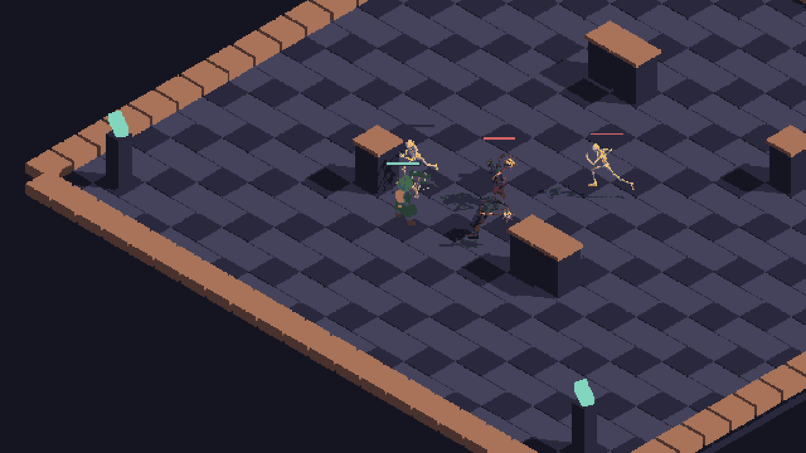
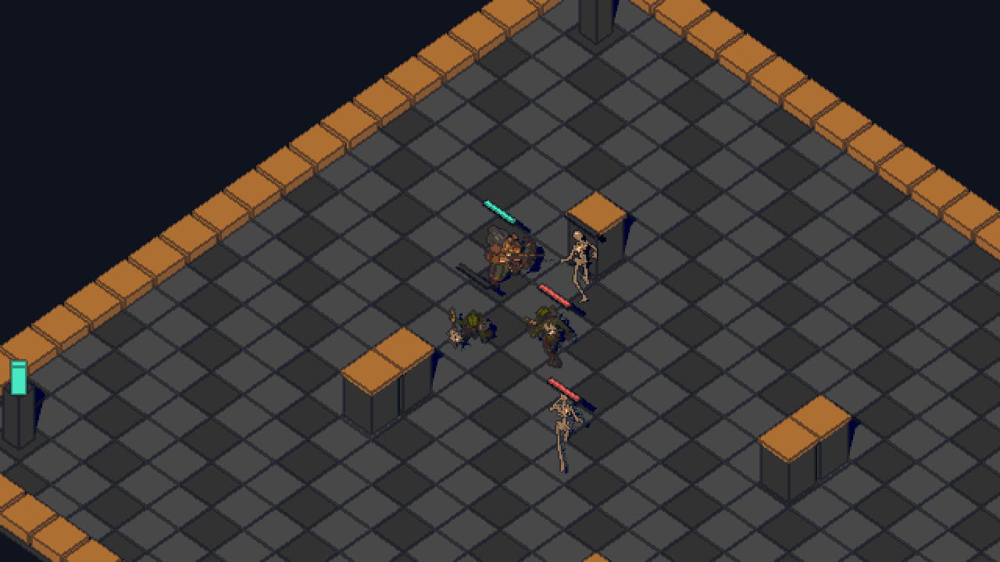
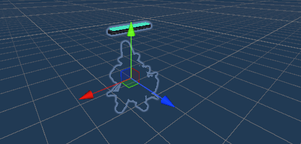
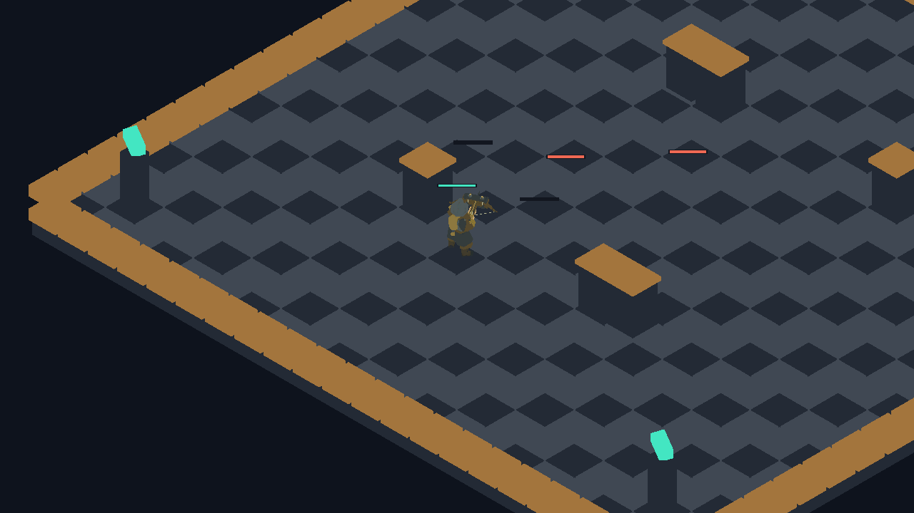
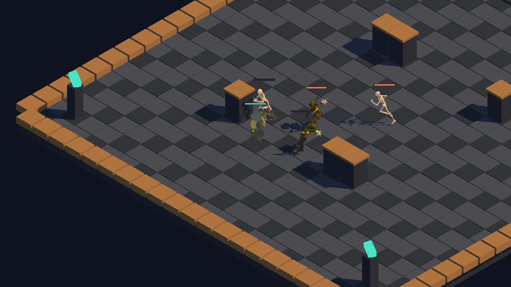
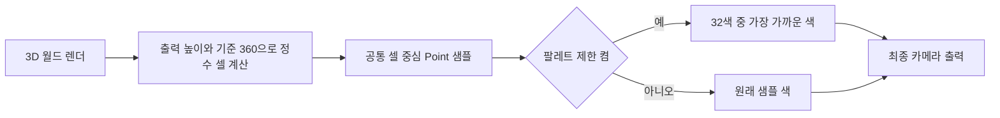
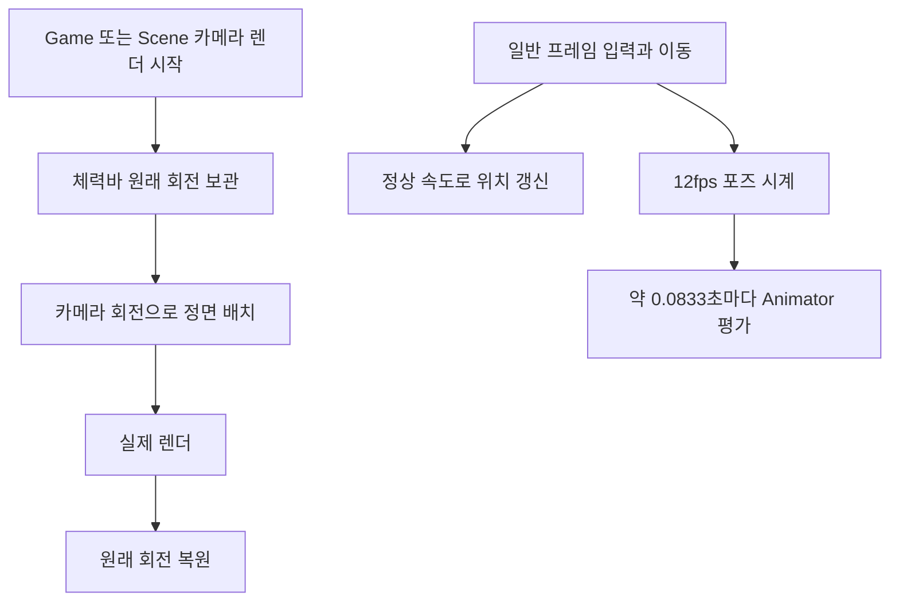

## 작업 결과



X 35.264°·Y 45°의 직교 아이소메트릭 뷰, 카메라별 체력바 빌보드, 12fps 캐릭터 포즈, DotAction 32색 팔레트를 적용했습니다. 이동과 입력은 원래 속도로 갱신합니다.

### 변경 전후




### 보이지 않는 모델의 원인 대조







재질 알파는 1이었고 2D 기본 렌더러에서 3D 표면이 보이지 않았습니다. 기본 렌더러를 Forward로 바꾸고 기존 2D 씬 카메라에는 렌더러 0을 명시했습니다. 위 두 진단은 같은 게임 카메라에서 렌더러만 바꾼 실제 출력이며, Scene 뷰 UI 캡처로 제시하지 않습니다.

오브젝트별 합성에서도 일부 표면 소실이 관찰돼 해당 합성은 끄고 프로젝트 소유 최종 화면 확장을 사용합니다. 플레이어의 프로젝트 소유 재질은 밝은 불투명 Unlit로 바꿨고 원본 텍스처는 보존했습니다.

### 픽셀·팔레트 전후


[1080p 원본](../assets/style-20261116/style-1080.png) · [측정 JSON](../assets/style-20261116/combat-style-measurement.json) · [실행 사본 대조](../assets/style-20261116/combat-style-source-comparison.json)

전체 설정 코드는 [CombatStyleSetup.cs](../assets/style-20261116/source/CombatStyleSetup.cs)에 보존했습니다. 외부 제품 원본은 수정·공개 첨부하지 않았습니다.

## 변경 내용

### 적용 내용

최종 렌더 타깃의 높이를 기준으로 정수 셀 크기를 계산하고 셀 중심의 Point 샘플 하나만 사용합니다. 모든 월드 출력에 같은 격자를 적용한 뒤 32색 중 하나로 매칭합니다.



```csharp
public override void RecordRenderGraph(RenderGraph graph, ContextContainer frameData)
            {
                UniversalResourceData resources = frameData.Get<UniversalResourceData>();
                UniversalCameraData cameraData = frameData.Get<UniversalCameraData>();
                CombatPixelStyle style = cameraData.camera.GetComponent<CombatPixelStyle>();
                if (style == null || !style.isActiveAndEnabled || resources.isActiveTargetBackBuffer)
                {
                    return;
                }
                int width = cameraData.cameraTargetDescriptor.width;
                int height = cameraData.cameraTargetDescriptor.height;
                int scale = style.pixelize ? Mathf.Max(1, height / style.referenceHeight) : 1;
                _material.SetVector("_PixelGrid", new Vector4(width, height, scale, 0));
                int count = style.limitPalette && style.palette != null ? style.palette.Count : 0;
                var colors = new Vector4[64];
                for (int i = 0; i < count; i++)
                {
                    Color color = style.palette.colors[i];
                    colors[i] = QualitySettings.activeColorSpace == ColorSpace.Linear ? color.linear : color;
                }
                _material.SetVectorArray("_Palette", colors);
                _material.SetInt("_PaletteCount", count);
                TextureHandle source = resources.activeColorTexture;
                TextureDesc descriptor = graph.GetTextureDesc(source);
                descriptor.name = "Uniform Pixel Palette";
                descriptor.clearBuffer = false;
                TextureHandle destination = graph.CreateTexture(descriptor);
                using (var builder = graph.AddRasterRenderPass<PassData>("DotAction uniform pixels and palette", out var data))
                {
                    data.source = source;
                    data.material = _material;
                    builder.UseTexture(source, AccessFlags.Read);
                    builder.SetRenderAttachment(destination, 0, AccessFlags.Write);
                    builder.SetRenderFunc((PassData pass, RasterGraphContext context) =>
                    {
                        Blitter.BlitTexture(context.cmd, pass.source, new Vector4(1, 1, 0, 0), pass.material, 0);
                    });
                }
                resources.cameraColor = destination;
            }
```

최종 셰이더 전체:

```hlsl
Shader "DotAction/Uniform Pixel Palette"
{
    SubShader
    {
        Tags { "RenderPipeline"="UniversalPipeline" }
        Pass
        {
            ZWrite Off ZTest Always Cull Off
            HLSLPROGRAM
            #pragma vertex Vert
            #pragma fragment Fragment
            #pragma target 3.5
            #include "Packages/com.unity.render-pipelines.universal/ShaderLibrary/Core.hlsl"
            #include "Packages/com.unity.render-pipelines.core/Runtime/Utilities/Blit.hlsl"
            float4 _PixelGrid;
            float4 _Palette[64];
            int _PaletteCount;

            float4 Fragment(Varyings input) : SV_Target
            {
                float2 uv = (floor(input.texcoord * _PixelGrid.xy / _PixelGrid.z) + .5) * _PixelGrid.z / _PixelGrid.xy;
                float3 color = SAMPLE_TEXTURE2D_X(_BlitTexture, sampler_PointClamp, uv).rgb;
                if (_PaletteCount > 0)
                {
                    float best = 1e20;
                    float3 mapped = _Palette[0].rgb;
                    for (int i = 0; i < _PaletteCount; i++)
                    {
                        float3 difference = color - _Palette[i].rgb;
                        float distance = dot(difference * difference, float3(.2126, .7152, .0722));
                        if (distance < best)
                        {
                            best = distance;
                            mapped = _Palette[i].rgb;
                        }
                    }
                    color = mapped;
                }
                return float4(color, 1);
            }
            ENDHLSL
        }
    }
}

```

## 검증

실제 Play Mode는 45.79초, 54셀 이동, 자동 발사60회, 24처치, 3웨이브 승리, 체력84, 런타임 오류0으로 끝났습니다. 저장·재열기와 원본 반영 후 씬·설정·소스 해시를 실행 사본과 대조했습니다.

| 실제 출력 | 셀 크기 | 검사 셀 | 혼합 셀 | 사용 색상 |
| --- | --- | --- | --- | --- |
| 1280×720 | 2×2 | 230400 | 0 | 22 |
| 1920×1080 | 3×3 | 230400 | 0 | 22 |

포즈 시간 표본의 중앙 갱신 간격은 0.083336초입니다. 5초 표본에서 61개 포즈 상태를 기록했으며 경계 표본을 포함한 관측률은 약12.05fps입니다. 제품의 Stepped Animator에 framesPerSecond=12를 저장했으며 게임 자체 FPS를 12로 제한하지 않았습니다. 빌보드 가로·세로 축과 카메라 축의 내적은 각각1.000000입니다.



빌보드 컴포넌트 전체:

```csharp
using UnityEngine;
using UnityEngine.Rendering;
using System.Collections.Generic;

namespace DotAction
{
    /// <summary>
    /// 체력바의 긴 축과 높이를 카메라 화면 축에 맞춘다.
    /// </summary>
    [ExecuteAlways]
    public sealed class HealthBillboard : MonoBehaviour
    {
        public Camera targetCamera;
        private readonly Dictionary<Camera, Quaternion> _rotations = new();

        private void OnEnable()
        {
            RenderPipelineManager.beginCameraRendering += BeginCamera;
            RenderPipelineManager.endCameraRendering += EndCamera;
        }

        private void OnDisable()
        {
            RenderPipelineManager.beginCameraRendering -= BeginCamera;
            RenderPipelineManager.endCameraRendering -= EndCamera;
            foreach (Quaternion rotation in _rotations.Values)
            {
                transform.rotation = rotation;
                break;
            }
            _rotations.Clear();
        }

        private void BeginCamera(ScriptableRenderContext context, Camera camera)
        {
            if ((camera.cameraType != CameraType.Game && camera.cameraType != CameraType.SceneView) || (targetCamera != null && camera != targetCamera))
            {
                return;
            }
            _rotations[camera] = transform.rotation;
            transform.rotation = camera.transform.rotation;
        }

        private void EndCamera(ScriptableRenderContext context, Camera camera)
        {
            if (_rotations.TryGetValue(camera, out Quaternion rotation))
            {
                transform.rotation = rotation;
                _rotations.Remove(camera);
            }
        }
    }
}

```

## 남은 사항

검증한 출력 해상도는 1280×720과 1920×1080입니다. 다른 해상도·플랫폼의 실제 실행과 출품용 PC 빌드는 미실행입니다. 사람이 직접 조작하는 체감 평가는 미확인입니다. Scene 뷰는 일반 3D 표시이며 픽셀·팔레트는 Game 뷰에서 확인합니다. 자동 테스트는 요청하지 않아 작성·실행하지 않았습니다. 기존 사용자 에디터를 보존했으며 별도 실행 사본은 유지했습니다.

대화 순서: 사용자는 체력바 빌보드·플레이어 투명 증상·12fps·전체 제한 색상을 요청했고 이어 픽셀 균일성 확인과 아이소메트릭 각도를 요청했습니다. 기존의 미니멀 UI 요구를 유지했습니다.

교훈은 프로젝트 지침에 통합했습니다. 기본 렌더러가 Scene 뷰의 3D 표시에 영향을 주는 점, 최종 PNG의 정수 셀을 직접 검사하는 기준을 기록했습니다. 전역 지침은 변경하지 않았습니다. 제품 고유 확장이므로 공통 샘플 환류는 보류합니다. [Unity 6 URP 렌더링 문서](https://docs.unity3d.com/6000.0/Documentation/Manual/urp/rendering-in-universalrp.html).

## 작업 시간

- 제안 시간: 20~30분. 시작 2026-11-16 18:59:39 KST.
- 실제로 완료된 시간: 구현·실행·원본 반영 완료 및 보고서 기록 2026-11-16 19:23:53 KST. 공개 배포 완료는 채팅에서 별도 기록합니다.
- XERJ: 미사용 — 사용자 지침에 따라 연결·호출 없이 rg와 실제 소스·설정·렌더 결과를 확인했습니다.
