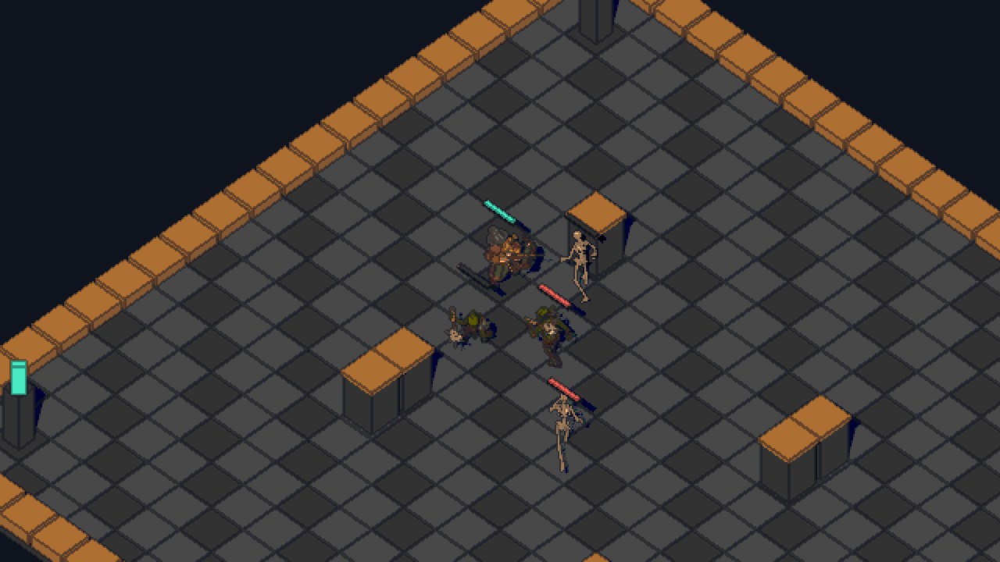

## 작업 결과

당시 세션의 결과 보고를 복원했습니다. 아래 기록은 해당 작업 시점의 결과이며 최신 버전 재검증을 뜻하지 않습니다.

## 변경 내용

### 적용 내용

결과 보고서·실제 게임 화면·프로젝트 소유 전투 코드(상용 에셋 원본 제외)를 MDJ0126/codex-config의 main에, 개발일지·썸네일을 MDJ0126/github-blog의 main에 공개 푸시해도 될까요? 자동 승인 검토가 이 구체적인 공개 업로드의 명시적 승인을 요구해 게시만 대기 중입니다.
- 두 저장소에 모두 공개
- 결과 보고서 저장소에만 공개
- 공개하지 않고 로컬 보관

디아블로 느낌의 가까운 추적 탑뷰로 바꾸고, 장식 UI·경로선·바닥 표식을 제거해 체력바만 남겼습니다.

3웨이브·24마리 처치, 런타임 오류 0건을 확인했습니다. 결과 보고서 검토본 (당시 로컬 자료; 공개 첨부 미확인)도 작성했습니다. PC 실행 파일 빌드는 아직 하지 않았습니다.

제안 35~50분, 구현 완료는 **51분 56초·18:14:21 KST**입니다.

자동 승인 검토가 공개 푸시와 임시 사본 삭제를 거부했습니다. 공개 게시 승인만 대기 중이며, 임시 사본은 보존했습니다. 위 승인 항목에서 공개 범위를 선택해 주세요.

## 검증

당시 세션 최종 보고에 명시된 검증 범위만 기록했습니다. 이번 등록에서는 게임 실행·청감·밸런스를 재검증하지 않았습니다.

## 남은 사항

현재 버전 동작은 미확인입니다. 기존 기록의 미확인·경고·후속 수정은 적용 내용에 보존했습니다. 원본 세션 전체 로그는 공개하지 않았습니다.

## 작업 시간

- 제안 시간: 당시 보고의 제안 시간 참조. 없으면 미기록.
- 실제로 완료된 시간: 당시 세션 종료: 2026-11-16T09:20:29.000Z / 세션 턴 실측 3494초. 보고서 복원: 2026-11-17T07:40:29.830Z
- XERJ: 미사용 — 코드 검색 근거가 제공되지 않았습니다.
