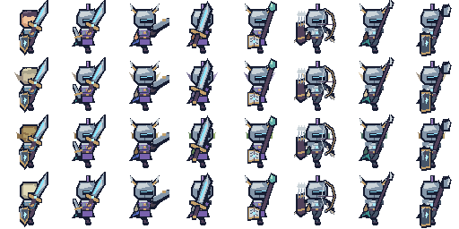

## 작업 결과

당시 세션의 결과 보고를 복원했습니다. 아래 기록은 해당 작업 시점의 결과이며 최신 버전 재검증을 뜻하지 않습니다.

## 변경 내용

### 적용 내용

**바뀐 루트 구조에 파츠 시스템을 구성했습니다.** 이번 작업은 `GodotGame` 아래에 저장하지 않았습니다.

- **F2:** 플레이어·동료의 종족, 피부색, 투구·의상·망토·무기·방패 변경
- 몬스터도 동일한 파츠 사용
- **15,360조합** 생성, 전체 미리보기 **60장**
- 이동·달리기·캐스팅·공격은 공통 파츠 프레임으로 합성

Windows 빌드 (당시 로컬 자료; 공개 첨부 미확인) · 전체 조합 ZIP (당시 로컬 자료; 공개 첨부 미확인) · Aseprite 파츠 원본 (당시 로컬 자료; 공개 첨부 미확인)

빌드·헤드리스 실행 확인했습니다. **F2 실제 마우스 조작은 미확인**이며, 무기별 별도 전투 규칙은 아직 추가하지 않았습니다.

제안 10분 / 실제 **9분 16초**, **22:07:35 KST** 완료.

## 검증

당시 세션 최종 보고에 명시된 검증 범위만 기록했습니다. 이번 등록에서는 게임 실행·청감·밸런스를 재검증하지 않았습니다.

## 남은 사항

현재 버전 동작은 미확인입니다. 기존 기록의 미확인·경고·후속 수정은 적용 내용에 보존했습니다. 원본 세션 전체 로그는 공개하지 않았습니다.

## 작업 시간

- 제안 시간: 당시 보고의 제안 시간 참조. 없으면 미기록.
- 실제로 완료된 시간: 당시 세션 종료: 2026-11-16T13:07:57.000Z / 세션 턴 실측 588초. 보고서 복원: 2026-11-17T07:40:29.807Z
- XERJ: 미사용 — 코드 검색 근거가 제공되지 않았습니다.
