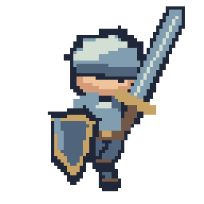
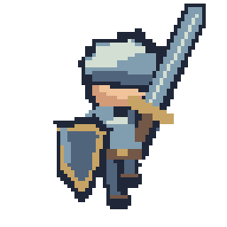

## 작업 결과

당시 세션의 결과 보고를 복원했습니다. 아래 기록은 해당 작업 시점의 결과이며 최신 버전 재검증을 뜻하지 않습니다.

## 변경 내용

### 적용 내용

**큰 머리 비율과 8방향 캐릭터로 다시 구성했습니다.**

- 앞·뒤·측면 얼굴과 장비 가림 순서 분리
- **걷기 8프레임 / 달리기 8프레임** 별도 제작
- 걷기는 접지·체중 이동, 달리기는 전경 자세·큰 보폭·체공 적용
- 실제 이동 거리에 맞춰 발 주기 재생

걷기:

달리기:

Windows 빌드 (당시 로컬 자료; 공개 첨부 미확인) · 8방향 Aseprite 원본 (당시 로컬 자료; 공개 첨부 미확인)

참고한 구현은 [Aseprite AI Artist의 탑뷰·8방향 규칙](https://github.com/with-pebbly/aseprite-ai-artist/blob/main/rules/47-top-down-animation.md)과 [Flare의 방향별 애니메이션 구조](https://github.com/flareteam/flare-engine/blob/master/docs/attribute-reference.html)입니다.

빌드·최종 EXE 헤드리스 실행 성공. **실제 창에서의 조작감은 미확인**입니다.

제안 10분 / 실제 **9분 8초**, **22:21:59 KST** 완료.

## 검증

당시 세션 최종 보고에 명시된 검증 범위만 기록했습니다. 이번 등록에서는 게임 실행·청감·밸런스를 재검증하지 않았습니다.

## 남은 사항

현재 버전 동작은 미확인입니다. 기존 기록의 미확인·경고·후속 수정은 적용 내용에 보존했습니다. 원본 세션 전체 로그는 공개하지 않았습니다.

## 작업 시간

- 제안 시간: 당시 보고의 제안 시간 참조. 없으면 미기록.
- 실제로 완료된 시간: 당시 세션 종료: 2026-11-16T13:22:26.000Z / 세션 턴 실측 586초. 보고서 복원: 2026-11-17T07:40:29.804Z
- XERJ: 미사용 — 코드 검색 근거가 제공되지 않았습니다.
