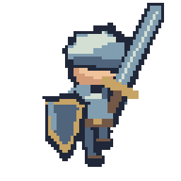

## 작업 결과

당시 세션의 결과 보고를 복원했습니다. 아래 기록은 해당 작업 시점의 결과이며 최신 버전 재검증을 뜻하지 않습니다.

## 변경 내용

### 적용 내용

**둘 다 제 생성 코드 오류였습니다.**

- 다리: 무릎을 옆으로 꺾던 계산을 제거해 역관절 모양 수정
- 투구: 확대 시 생기던 빈 픽셀 줄 제거
- 에디터 미리보기도 변경된 이미지를 다시 읽도록 수정

수정된 Windows 빌드 (당시 로컬 자료; 공개 첨부 미확인)

프레임 이미지 확인·빌드·EXE 헤드리스 실행 성공. 실제 조작감은 미확인입니다.

제안 5분 / 실제 **2분 31초**, **22:26:21 KST** 완료.

## 검증

당시 세션 최종 보고에 명시된 검증 범위만 기록했습니다. 이번 등록에서는 게임 실행·청감·밸런스를 재검증하지 않았습니다.

## 남은 사항

현재 버전 동작은 미확인입니다. 기존 기록의 미확인·경고·후속 수정은 적용 내용에 보존했습니다. 원본 세션 전체 로그는 공개하지 않았습니다.

## 작업 시간

- 제안 시간: 당시 보고의 제안 시간 참조. 없으면 미기록.
- 실제로 완료된 시간: 당시 세션 종료: 2026-11-16T13:26:28.000Z / 세션 턴 실측 168초. 보고서 복원: 2026-11-17T07:40:29.802Z
- XERJ: 미사용 — 코드 검색 근거가 제공되지 않았습니다.
