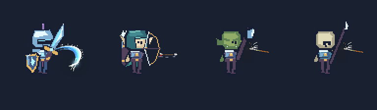

## 작업 결과

당시 세션의 결과 보고를 복원했습니다. 아래 기록은 해당 작업 시점의 결과이며 최신 버전 재검증을 뜻하지 않습니다.

## 변경 내용

### 적용 내용

이펙트에 맞춰 투구 실루엣과 검·갑옷·방패를 재구성했습니다. 청백색 금속과 빛 포인트를 사용하고, 궁수는 청록색으로 구분했습니다.

분리 파츠·8방향 시트·씬 미리보기·Aseprite 원본과 Windows 빌드를 갱신했습니다. 컴파일은 통과했고, 실행 로그에는 별도 OGG 오디오 오류가 남아 있습니다. 실제 게임 화면은 미확인입니다.

제안 10분 / 실제 약 3분 30초, 22:41 KST 완료.

## 검증

당시 세션 최종 보고에 명시된 검증 범위만 기록했습니다. 이번 등록에서는 게임 실행·청감·밸런스를 재검증하지 않았습니다.

## 남은 사항

현재 버전 동작은 미확인입니다. 기존 기록의 미확인·경고·후속 수정은 적용 내용에 보존했습니다. 원본 세션 전체 로그는 공개하지 않았습니다.

## 작업 시간

- 제안 시간: 당시 보고의 제안 시간 참조. 없으면 미기록.
- 실제로 완료된 시간: 당시 세션 종료: 2026-11-16T13:41:29.000Z / 세션 턴 실측 231초. 보고서 복원: 2026-11-17T07:40:29.799Z
- XERJ: 미사용 — 코드 검색 근거가 제공되지 않았습니다.
