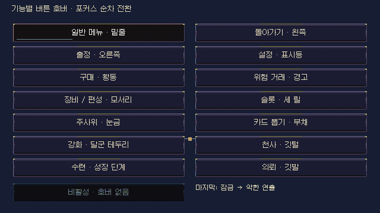

## 작업 결과

구현 및 Godot 4.7.2 로딩과 14종 실제 렌더링 완료. 게임 전체 화면별 수동 조작은 미확인입니다.

## 변경 내용

### 적용 내용

일반 밑줄, 좌우 방향, 설정 표시등, 황동 거래, 위험 경고, 장비 모서리, 슬롯 릴, 주사위 눈금, 카드 부채, 강화 열기, 천사 깃털, 수련 단계, 의뢰 깃발을 연결했습니다. 증강과 손패는 기존 등급 포일을 재사용하고 일반 카드의 반복 별빛 및 일괄 상승을 줄였습니다. 공통 버튼 생성 경로와 빈 제목 버튼, 개발 커스터마이저를 확인했습니다.

## 검증

Godot 4.7.2 headless 프로젝트 실행에서 스크립트 오류 없음. GTX 970 OpenGL 실제 렌더링으로 14종과 disabled/locked/reduced 상태를 순차 확인했습니다. tools/preview-button-hover.gd로 198프레임을 출력했습니다. 종료 시 리소스 해제 경고 및 user:// 셰이더 캐시 폴더 경고가 남았습니다. 새 테스트·회귀 테스트는 실행하지 않았습니다.

## 남은 사항

실제 게임의 모든 메뉴를 직접 클릭한 검증과 사용자 체감 평가는 미확인입니다. 프로젝트 빌드·설치·게임 소스 푸시·게임 배포는 수행하지 않았습니다. 추가 지침 변경 없음: 기능별 옵션 추가이며 기존 픽셀 UI 기준을 유지합니다.

## 작업 시간

- 제안 시간: 8~10분
- 실제로 완료된 시간: 시작 2026-11-17 16:36:33 KST. 구현 및 렌더링 완료 16:41 KST, 약 5분. 보고 등록 시간은 게시 이력으로 구분합니다.
- XERJ: 미사용 — 사용자 지침에 따라 사용하지 않았습니다.
