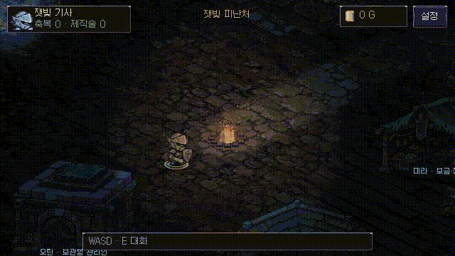

## 작업 결과

구현·정규화·Godot 임포트 및 실제 렌더 완료. 플레이 체감 평가는 미확인.

## 변경 내용

### 적용 내용

후드4명(금고/슬롯/카드/악마). 나머지는 머리·모자로 구분. NPC14명 외곽선/이름 호버와 발 고정 호흡·고개 움직임. 천막 바람/굴뚝 연기/등불, 나무 가지 바람, 풀109개, 까마귀 대기·비행, 낙엽4프레임 연결. 원본·이전 출력 보존 및 관련 아트 지침 통합.

## 검증

Godot4.7.2 실제10.5초 렌더: npcs=14 grass=109 outlines=14 errors=[]. 스크립트 오류 없음. 최종 PNG와 일러스트6장 대조. 기존 종료 시 GLES3 텍스처3개 해제 경고는 남았습니다.

## 남은 사항

실제 사용자 체감 및 마을 전체 장기 플레이 미확인. 대기 모션은 이미지 분할 기반 호흡/고개 움직임이며 새 손동작 프레임은 추가하지 않았습니다.

## 작업 시간

- 제안 시간: 약10분. 시작2026-11-17 16:34:31 KST.
- 실제로 완료된 시간: 구현/렌더 확인2026-11-17 16:42 KST, 약7분30초. 보고 게시 시간은 Git 이력에 별도 기록.
- XERJ: 미사용 — 사용자 지침에 따라 rg로 관련 소스만 확인.
