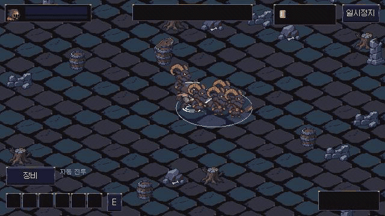

## 작업 결과

구현·원본 저장·Godot 임포트·실제 전투 확인을 완료했습니다. 중앙 아카이브 게시 절차는 이 보고서의 등록 이력과 별도로 확인합니다.

## 변경 내용

### 적용 내용

- 대기·걷기·평타·이동 평타·피격·사망·전용기40자세와 충전 강타24자세를 양손도끼로 재제작했습니다. 기존 방패/도끼 원본은 보존했습니다.
- 일반 평타와 특수 스킬을 분리했습니다. 재앙의 지면 강타는1초 충전 후 전방1.6칸의 고정 중심·반경2.8칸에 공격력400%를1회 적용하고, 생존 적에게0.85초 에어본을 줍니다. 회수0.5초, 기본 재사용8초입니다.
- 충전 중 이동을 제한하고 E·사망·강한 제어로 취소합니다. 예고와 실제 판정이 같은 중심/반경을 공유합니다. 보스에는 기존 제어 감쇄를 적용합니다.
- 충전·베기·지면 균열/2:1 충격파·파편 FX와 기존 공유 충격 사운드를 연결했습니다. 정규화 출력만 게임에 사용합니다.
- 다른7클래스에는 이미 전용 자동 스킬이 연결되어 있음을 데이터로 확인했습니다. 중복 스킬을 추가하거나 기존 평타를 교체하지 않았습니다.
- 프로젝트 지침·파츠/아트 가이드·제작 절차·스타일 메타데이터를 갱신했습니다.

## 검증

Godot4.7.2 / Windows / GTX970 실제 전투6초를 엔진 Movie Maker로 렌더했습니다. basic=true, special=true, hits=4, airborne=4, max_lift_px=30.0, outside_slam_damage=0.0, charge_displacement=0.0, shield=none, data_errors=[]를 확인했습니다. 충전 예고/도끼 궤적/지면 충격/파편 FX 발생도 확인했습니다. 원본과 정규화 시트를 직접 대조했으며 평타12자세·걷기12자세·강타24자세는 각각 다른 픽셀 출력입니다. 테스트 코드나 전체 회귀 테스트는 추가하지 않았습니다.

## 남은 사항

종료 시 기존 텍스처3개 해제 경고가 남습니다. 주관적 청감·장기 밸런스·보스별 체감 제어는 미확인입니다. 다른7클래스는 이번 작업에서 데이터 연결만 확인했으며 새 전투 회귀를 수행하지 않았습니다. 게임 자체의 커밋·푸시·배포는 수행하지 않습니다.

## 작업 시간

- 제안 시간: 25~35분(원본 재제작·FX·구현·실행 확인·이번 요청의 중앙 보고 등록)
- 실제로 완료된 시간: 착수2026-11-17 16:31:27 KST. 구현·전투 확인16:46:37 KST(15분10초), 프로젝트 기록 반영16:48:01 KST(16분34초). 중앙 보고서 작성·등록 일시는 게시 메타데이터로 구분합니다.
- XERJ: 미사용 — 사용자 지침에 따라 XERJ는 연결 확인을 포함해 사용하지 않았습니다.
