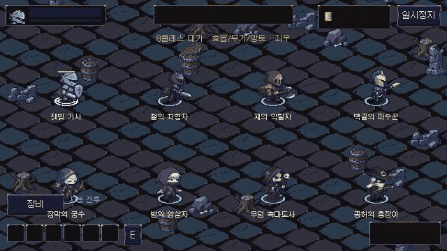

## 작업 결과

원본64프레임 제작·저장·정규화·Godot 임포트·컴파일·실제 렌더 확인을 완료했습니다. 전투와 마을의 정지 분기를 공통 대기 API에 연결했습니다.

## 변경 내용

### 적용 내용

- 기사/처형자/약탈자/파수꾼/궁수/암살자/흑마도사/총잡이에8프레임씩 총64프레임을 새로 그렸습니다. 약탈자는 방패 없는 양손도끼를 유지합니다.
- 발(40,64)/80×80/서 있는 높이46px에 정합하고 클래스별1.4~1.9초 루프를 사용합니다. 가슴·어깨·무기·망토의 작은 움직임과 얼굴이 보이는 클래스의 짧은 눈 깜빡임을 추가했습니다.
- class_system.idle_pose/idle_texture를 전투 플레이어·공유 동료·마을 플레이어가 사용합니다. uid별 시작 위상을 달리해 일제히 같은 박자로 움직이지 않게 했습니다.
- 대기 시트를 별도 파일로 추가했습니다. 기존 걷기·평타·특수기·피격·사망 원본과 시트는 수정하지 않았으며, 해당 동작의 우선순위를 유지했습니다.
- 전체 프롬프트와 원본은 tools/class-idles-v9-sources.json / art/source/classes/idle-v9, 발 정합·프레임 해시·주기는 art/classes/idle-v9.json에 보존했습니다. 편집 가능한 class_idle_preview.tscn도 추가했습니다.

## 검증

Godot4.7.2 / Windows / GTX970에서 실제 플레이어·동료 렌더러로8초 영상을 기록했습니다. 각8클래스가 runtime_poses100~107의8프레임을 모두 사용하고 좌우 출력을 제공하는 것을 확인했습니다. data_errors=[]입니다. 정규화 후 각 클래스의8/8개 프레임 해시가 서로 다르고 이진 알파/발 기준/캔버스를 기록했습니다. 캡처의8명 배치는 미리보기 전용이며 실제 동료 편성 상한5명은 변경하지 않았습니다. 신규 테스트나 전체 전투 회귀 테스트는 추가하지 않았습니다.

## 남은 사항

종료 시 기존 텍스처3개 해제 경고가 남습니다. 마을 정지 분기 연결과 컴파일은 확인했으나 이번 영상에서 마을 전체를 별도로 시각 검사하지 않았습니다. 전투 밸런스·공격 전환 전체 회귀는 이번 변경 범위에서 수행하지 않았습니다. 게임 자체 커밋·푸시·배포는 수행하지 않습니다.

## 작업 시간

- 제안 시간: 20~30분(8클래스 원본 제작·연결·실제 렌더 확인·중앙 보고 등록)
- 실제로 완료된 시간: 착수2026-11-17 16:56:15 KST. 원본 제작·구현·실제 렌더 확인17:09:27 KST(13분12초). 중앙 보고서 작성·등록 시각은 게시 메타데이터와 구분합니다.
- XERJ: 미사용 — 사용자 지침에 따라 XERJ는 연결 확인을 포함해 사용하지 않았습니다.
