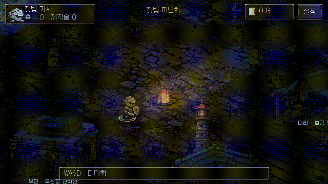

## 작업 결과

직업별84자세 제작·정규화·연결 및 Godot 실제 렌더 완료. 봉화탑6기와 바닥 조명 연결. 사용자 체감 평가는 미확인.

## 변경 내용

### 적용 내용

기존3분할 호흡/고개 변형을 제거했습니다. 망치질/상품 정리/촛불 관리/활 점검/열쇠 정리/검 손질/레버 조작/주사위/카드 셔플/성물 닦기/계약 날인/상자 점검/명부 확인/의뢰 필기를6자세로 재생합니다. 손·팔·소품과 상체가 움직이며 프레임별 원본 셀 좌표를 공유합니다. 후드4명/기존 일러스트 정체성 유지. 길목6곳에 소형 봉화탑을 추가하고 충돌/Y정렬/따뜻한 주변 조명 반경185px를 연결했습니다. 원본/프롬프트/해시와 아트 가이드를 동기화했습니다.

[14명 실제 마을 렌더 영상](../assets/town-professions-v5.mp4)

## 검증

Godot4.7.2 실제42초 렌더: npcs=14, profession_loops=14, beacons=6, errors=[]. 스크립트 오류 없음.84자세 출력 대조 및 출정 담당 외곽 잔여색 보정. 기존 종료 시 GLES3 텍스처3개 해제 경고는 남았습니다.

## 남은 사항

사용자 체감/장기 플레이 및 모든 상점 대화·경로 회귀는 미확인. 별도 테스트는 요청 범위에 없어 추가하지 않았습니다.

## 작업 시간

- 제안 시간: 약10분. 시작2026-11-17 17:03:15 KST. 생성 대기 지연을 안내하고17:17 전후로 수정 예상.
- 실제로 완료된 시간: 구현·실제 렌더 확인2026-11-17 17:18 KST 전후, 약15분.14개 개별 이미지 생성 대기와 외곽 잔여색 보정으로 예상 초과. 게시 완료 시간은 Git/배포 이력과 채팅에 구분.
- XERJ: 미사용 — 사용자 지침에 따라 rg와 관련 소스 확인만 사용.
