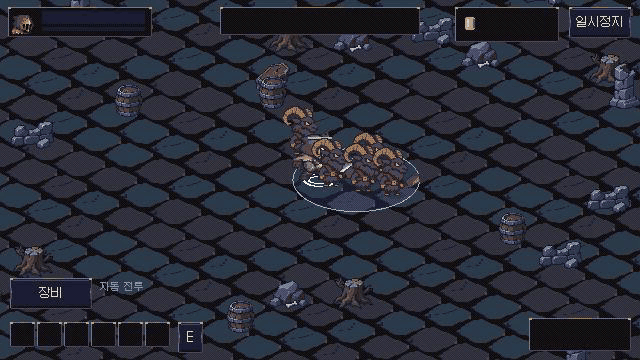

## 작업 결과

도끼 FX 수정·정규화·Godot 임포트·컴파일·정지/이동 평타 및 충전 강타 실제 렌더 확인을 완료했습니다.

## 변경 내용

### 적용 내용

- 원인: 기존 평타 FX가4~9번 자세에만 출력되어 실제 내려찍기10~11번에는 투명했습니다. 명중은62% 시점이었으나 해당 시점의 도끼는 머리 위에 있었습니다.
- weapons.axe.impact_ratio=0.86을 플레이어·동료가 공유하도록 수정했습니다. 피해량·공격 주기는 유지했습니다.
- 평타 잔상을 마지막 자세까지 연장하고 중심선/폭을 보강했습니다. 실제 피해 시점에 명중 섬광·파편을 생성합니다. 충전 강타의 베기·지면 충격파도 보강했습니다.
- 제작기 tools/export-ravager-slam-fx-v8.mjs와 정규화 출력 및 관련 프로젝트 지침을 저장했습니다.

## 검증

Godot4.7.2/GTX970 실제 전투6초에서 basic=true/basic_impact_fx=true/moving_trail_fx=true/special=true/data_errors=[]를 확인했습니다. 강타는4명 에어본/30px 상승/범위 밖 강타 피해0/충전 이동0/방패none을 유지했습니다. 실제 캡처에서 평타 명중 섬광과 강타 충격파를 직접 대조했습니다. FX 아틀라스의 마지막 프레임 불투명 픽셀은0→162, 최대 궤적은69→277로 확인했습니다. 별도 테스트·전체 회귀는 추가하지 않았습니다.

## 남은 사항

기존 종료 시 텍스처3개 해제 경고는 남습니다. 주관적 청감·장기 밸런스는 미확인입니다. 게임 자체 커밋·푸시·배포는 수행하지 않습니다.

## 작업 시간

- 제안 시간: 5~10분(실제 확인·FX/명중 시점 보정·원본 저장·중앙 보고 등록)
- 실제로 완료된 시간: 착수2026-11-17 17:17:05 KST. 구현·최초 실제 렌더17:21:32 KST(4분27초), 이후 이동 평타를 포함한 동일 범위 재확인을 완료했습니다. 게시 등록 시각은 보고서 메타데이터로 구분합니다.
- XERJ: 미사용 — 사용자 지침에 따라 XERJ는 연결 확인을 포함해 사용하지 않았습니다.
