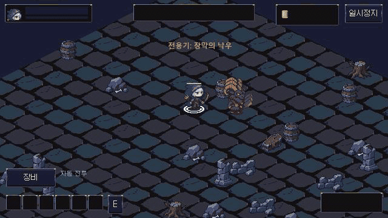

## 작업 결과

신규4종 전용기 구현·정규화·Godot 임포트·실제 렌더 확인 완료. 게임 배포/푸시는 수행하지 않았습니다.

## 변경 내용

### 적용 내용

궁수: 위로 당겨3파 화살비(각120%,8초). 암살자: 낮은 준비→최대2.4칸 실제 이동→쌍검2회+X 마무리(80/80/144%,7초). 흑마도사: 지팡이 거상→지면 누르기→뼈손 속박1.1초/폭발(합산380%,9초). 총잡이: 무릎 조준→강한 반동의 직선 관통탄(420%,최대6명,8초).

각24자세/80×80/발(40,64) 신규 원본·프롬프트·출력·무기 부착점·PixelFX·기존 시작 스킬 ID·툴팁·편집 씬을 연결했습니다. 평타/대기와 기존 기사/처형자/창기사/약탈자 전용기는 유지했습니다. 뼈손 앞뒤 가림, 원형 바닥 예고, 벽에서 끝나는 관통 예고/판정, 준비 취소와 발동 후 잔류를 구현했습니다.

## 검증

Godot4.7.2 expedition.gd check-only 성공, 자산 임포트 완료. 실제 GTX970/OpenGL 렌더에서 신규4종 모두 basic=true/special=true/양수 피해/고유 FX/data_errors=[] 확인. 신규96개 자세는 클래스별24개 고유 해시입니다. 실제 렌더를 통해 PixelFX 색 문자열로 발생한 투명 출력을32비트 팔레트로 수정하고 화살비/뼈손/교차 베기/총구 관통탄을 확인했습니다. 기존 기사2행/처형자회전/창기사3행도 첫8클래스 실행에서 확인했습니다. 최종 영상은 build/previews/signatures-v11.mp4 및 GIF입니다. 다른 세션의 저장/부대 HUD 수정과 분리하기 위해 최종 캡처는 메모리 저장/부대 HUD 숨김을 사용했습니다. 자동 테스트는 작성/실행하지 않았습니다. 보고서 게시 중 기존 SNSManager SVG 로고를 PNG로만 검사하던 아카이브 오류를 확인했습니다. 등록된 SVG의 xmlns/닫힘 태그 검사와 기존 PNG 검사를 함께 지원하도록 verify.mjs를 보정한 뒤1792개 보고서/61916개 로컬 링크 검사가 통과했습니다.

## 남은 사항

기존 종료 시3개 GL 텍스처 해제 및 RenderingServer null 경고는 남습니다. 실제 청감·장기 밸런스·현재 저장 흐름은 미확인입니다. 승인된 다른4종 모션은 교체하지 않았습니다. 중앙 보고서만 별도 커밋/푸시/배포 대상이며 게임 배포는 하지 않았습니다. 검증된 PixelFX 색상 교훈은 프로젝트 지침에 추가했고 기존 아트 방향은 유지했습니다.

## 작업 시간

- 제안 시간: 30~40분. 시작2026-11-17 17:51:42 KST.
- 실제로 완료된 시간: 구현·임포트·실제 렌더 확인22분58초, 완료2026-11-17 18:14:40 KST. 보고서 작성·게시 시각은 등록 이력으로 구분합니다.
- XERJ: 미사용 — 로컬 소스/데이터와 Godot 실제 렌더 로그로 검증했습니다. XERJ는 연결 확인을 포함해 사용하지 않았습니다.
