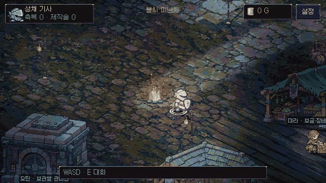

## 작업 결과

마을 플레이어·NPC 조명 구현·저장·Godot 실제 렌더 확인 완료. 원본 보존. 게임 EXE 빌드·배포 미실행.

## 변경 내용

### 적용 내용

actor_relief.gd에서 현재 정규화된 배우 텍스처의 알파 실루엣과 약한 명암으로 기술용 노멀을 메모리 파생·캐시합니다. actor_relief.gdshader에서 빛의 방향·거리·높이와 4단계 명암을 계산합니다. town.gd/town_life.gd에 연결해 모닥불·NPC 등불·가로등을 반영하며 바닥·FX·UI·선택 외곽선은 유지합니다. 아트 가이드·스타일 JSON·변경 이력에 적용 범위를 기록했습니다. 원본 이미지 변경이나 기존 사용자 수정 덮어쓰기는 없습니다.

## 검증

Godot 4.7.2 실제 OpenGL GTX 970 렌더 75프레임/12FPS 영상 저장. 캐시22개·광원21개 연결 확인. 실제 PNG에서 기존 도트 실루엣·마을 조명 합성을 확인했습니다. 초기 GDScript 타입 추론 오류는 명시적 Vector2i로 수정한 뒤 실제 실행에 성공했습니다. 별도 테스트·회귀는 수행하지 않았습니다.

## 남은 사항

자동 추정 노멀이므로 수제 표면 노멀만큼 정교하지 않으며 실제 3D 형상/광원 차폐는 없습니다. 전투 FX의 광원화는 이번 구현에 포함하지 않았습니다. 전체 클래스·NPC 개별 근접 조명 및 체감 성능은 미확인입니다. 종료 시 기존 보고에도 기록된 GL 텍스처3개 해제 경고가 남았습니다. EXE 빌드·게임 배포 미실행. 중앙 푸시·배포는 별도 상태로 보고합니다. 기존 지침과 대조해 별도 교훈 추가 없음.

## 작업 시간

- 제안 시간: 2026-11-17 18:48:00 KST 시작, 약8~10분.
- 실제로 완료된 시간: 구현·실제 렌더 확인 2026-11-17 18:52:00 KST, 실측4분. 결과 보고 작성 18:53 KST.
- XERJ: 미사용 — rg로 마을 배우·조명·캐시 연결을 확인했습니다.
