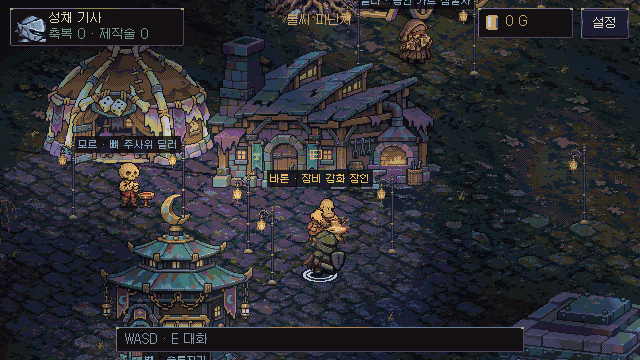

## 작업 결과

건물 등불 배치·공통 광원 연결·저장 및 실제 Godot 렌더 확인 완료.

## 변경 내용

### 적용 내용

town.json.facilities[].entrance_lamps에 위치·반경·세기를 저장해 시설14곳에 등불28개를 배치했습니다. 기존 정규화된 가로등 소품을 재사용하고 공통 깊이 정렬/그림자를 연결했습니다. NPC 위치에서 자동 생성하던 가상 광원은 제거했습니다. 실제 전구 위치와 높이를 darkness.gdshader와 actor_relief.gdshader가 공유해 건물 주변 바닥·외벽과 NPC·플레이어 표면에 반영합니다. 화면 광원40개/배우 광원48개로 확대했습니다. 캐릭터의 낮은 주변광과 중앙 모닥불·외곽 암부는 유지했습니다. 아트 방향·제작 절차·스타일·변경 이력을 갱신했고 원본 이미지는 보존했습니다.

## 검증

Godot4.7.2/GTX970 실제 렌더99프레임/12FPS. facilities=14, entrance_lamps=28, actor_lights=35, normal_cached=22, data_errors=[] 확인. 대장간·상인 등 대표4곳을 렌더하고 대장간/상인 캡처에서 실제 등불 배치·건물 주변 조명·NPC 명암을 확인했습니다. 별도 테스트·회귀는 수행하지 않았습니다.

## 남은 사항

시설14곳 전체 개별 배치의 사용자 체감·실제 플레이 성능은 미확인입니다. 기존 종료 시 GL텍스처3개 해제 경고가 남습니다. EXE 빌드·게임 배포 미실행. 중앙 보고 푸시·배포·보호 페이지 접근은 최종 상태로 구분합니다. 검증된 제작 규칙은 기존 프로젝트 아트 가이드에 통합했으며 전역 지침 변경은 없습니다.

## 작업 시간

- 제안 시간: 2026-11-17 19:14:48 KST 시작,5~8분.
- 실제로 완료된 시간: 구현·실제 렌더 확인 2026-11-17 19:17:10 KST, 실측2분22초. 보고 등록은 이후 별도.
- XERJ: 미사용 — rg와 현재 마을 소스·시설 데이터·실제 렌더를 확인했습니다.
