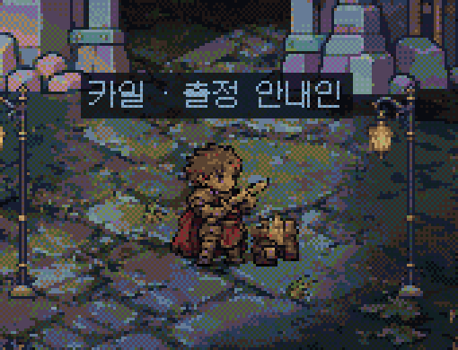

## 작업 결과

구현·메타데이터 저장·부분재출력·정규화·실제 Godot 렌더 완료.게임EXE 빌드/배포 미실행.

## 변경 내용

### 적용 내용

--only 분기에서 현재72프레임 durations를 다시12분할한 오류였습니다. 원래6키포즈 key_durations를 별도 보존하고 양수6개 검사를 추가했습니다. 현재 카일72프레임 시간을 원본v5의0.5/0.35/0.35/0.35/0.35/0.6초에서 복원했습니다. 다른NPC시간과 스프라이트 디자인은 유지합니다. 제작절차·변경이력·프로젝트 지침에 재분할 금지와 주기 대조를 기록했습니다. 이전 외곽선 확인은 재생속도 검증을 놓쳤음을 정정합니다.

## 검증

카일72프레임 합계0.25초→2.5초. 수정제작기로 실제 카일만 재출력 후 합계2.5초 유지. 정규화후 RGBA SHA256이 기존 조명베이크 source_sha256과 일치하여 이미지변경 없음을 확인했습니다. 실제 Godot4.7.2 GTX970 OpenGL36프레임/12FPS,data_errors=[],normal_loaded=22. 기존셰이더캐시권한 및 종료GL텍스처3개 경고는 남았습니다. 별도테스트/전체회귀 미실행.

## 남은 사항

EXE 빌드·게임 배포 미실행. 실행중인 기존게임은 재실행 필요. 중앙보고 등록/푸시/배포/접근은 후속기록.

## 작업 시간

- 제안 시간: 2026-11-17 20:43:01 KST 시작,3~5분 제안.
- 실제로 완료된 시간: 구현·재출력·실제렌더 완료 2026-11-17 20:44:49 KST,실측 109초.
- XERJ: 미사용 — rg·원본키시간과런타임메타데이터대조·재출력·Godot렌더
