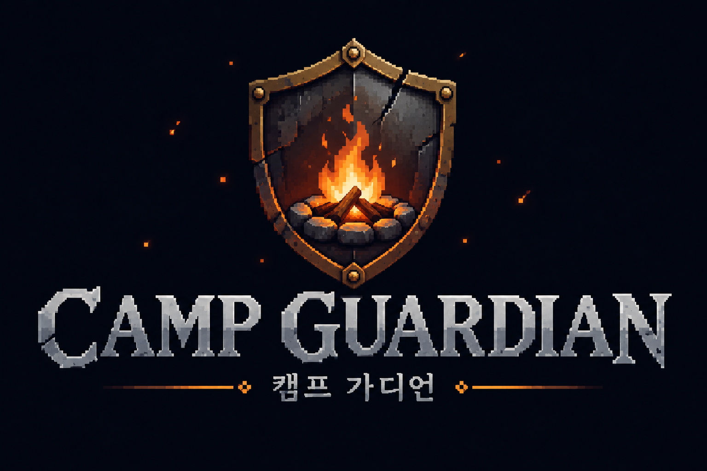
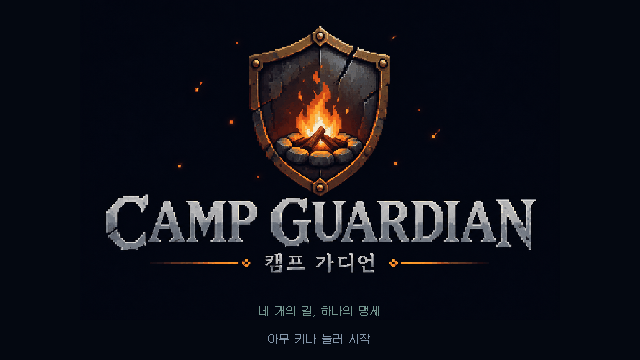

## 작업 결과

프로젝트 이름과 로고 설정, README, 시작 화면 소스 저장 완료.

## 변경 내용

### 적용 내용

중앙 프로젝트 ID와 기존 글 주소는 dotaction으로 보존하고 표시 이름만 캠프 가디언으로 변경했습니다. 내장 ImageGen 원본과 프롬프트를 보존하고 게임용 PNG를 정규화했습니다. README의 오래된 조작·콘텐츠 설명을 현재 지침에 맞게 갱신했습니다. 시작 화면은 승인된 로고를 표시합니다. 기존 다른 작업은 보존했습니다. 지침 변경 없음: 기존 자산 원본 보존 규칙으로 처리했습니다.

## 검증

지정 PNG 정규화와 중앙 사이트 빌드(1822개 보고서)를 완료했습니다. 실제 Godot 4.7.2 OpenGL 렌더링 12프레임을 저장하고 시작 화면의 로고·한글·안내 배치를 확인했습니다. 헤드리스 임포트와 캡처는 종료코드0이지만 도구 폴더 저장 권한·종료 시 텍스처 해제 경고가 있었습니다. 테스트는 요청하지 않아 실행하지 않았습니다.

## 남은 사항

배포 확인은 최종 응답 참조. 기존 EXE 재빌드는 미실행입니다.

## 작업 시간

- 제안 시간: 2026-11-17 20:58:20 KST 시작, 8~10분
- 실제로 완료된 시간: 2026-11-17 20:58:20~21:05 KST 약7분, 소스·자산·렌더링 완료. 게시 완료 시각은 최종 응답 참조.
- XERJ: 미사용 — rg와 소스·설정으로 확인했습니다.
