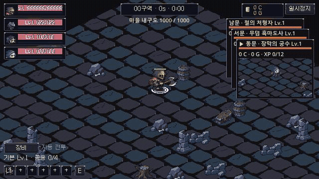

## 작업 결과

구현·저장·실제 Godot 렌더와 순차 진행 확인 완료. 게임 배포 빌드는 미실행입니다.

## 변경 내용

### 적용 내용

일반 웨이브는 별도 wave_clear_notice.gd의 작은 상단 알림으로 약0.98초 표시하며 큰 문양·충격파·팡파레를 제거했습니다. 적 동시 제거와 다음 웨이브 재개는 유지합니다. 최종 승리 제목은 수호 성공으로 변경했습니다. captain_results_reel.gd는 대장별 초상·이름·레벨·경험치·재화를 한 명씩 표시하고 경험치0.66초 재생 후 옆으로 넘기는1.22초 흐름을 반복합니다. four_captains.settle에 실제 누적 경험치·다음 레벨 임계값을 결과로 보존하고 기존 성장 곡선에 따라 이번 전투의 실제 경험치/레벨만 재생합니다. 추가 경험치를 지급하지 않습니다. 모든 대장 표시가 끝나면 최종 정산·귀환 버튼을 공개하며 중복 입력을 잠급니다. 약한 연출은 슬라이드 대신 페이드합니다. 기존 UI 카드 프레임·초상을 재사용해 디자인 기준/제작 지침 변경은 없습니다.

## 검증

Godot4.7.2/GTX970/OpenGL/640×360/30FPS 실제 Movie Maker437프레임 실행. WAVE_REVEAL enemies=0 paused=true, WAVE_RESUMED wave=2 paused=false. 대장 index0~3이67/146/222/332 XP 및 최종4/5/7/8레벨로 순차 표시됐습니다. 연출 중 locked=true, 전체 종료 후 REEL_FINISHED locked=false results=4, data errors=[] 확인. 녹화 전용 임시 저장과 기존 경험치 지급 경로로 샘플 수치를 구성했으며 실제 사용자 저장은 변경하지 않았습니다. 실제 알림/대장 화면 확인.

## 남은 사항

직접 플레이의 연출/청감 평가는 미확인. 기존 user:// 로그·셰이더 캐시 접근 경고와 종료 텍스처3개 해제 경고가 남습니다. 게임 배포 빌드 미실행. 중앙 보고 등록·푸시·웹 배포는 별도 확인합니다.

## 작업 시간

- 제안 시간: 2026-11-17 21:04:45 KST 시작,10분 이내 구현·실행 확인.
- 실제로 완료된 시간: 구현·실제 렌더·GIF 저장21:07:19 KST 완료,실측2분34초. 결과 보고 등록 시간은 별도입니다.
- XERJ: 미사용 — rg·관련 소스·실제 Godot 렌더/진행 로그 확인. 자동 테스트는 요청되지 않아 작성·실행하지 않았습니다.
