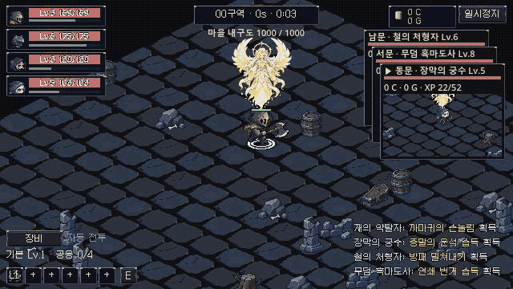

## 작업 결과

구현·저장·실제 Godot 렌더·오디오 출력 확인 완료. 게임 배포 빌드는 미실행입니다.

## 변경 내용

### 적용 내용

대장 결과 카드348×100을286×82로,초상64px를48px로 줄였습니다. 글자를 부모 배율로 줄이지 않고 이름/정보를11px로 배치하며 경험치 바·간격·슬라이드 이동 폭을 조정했습니다. 자동 증강 주사위는 HUD에서도 보이므로 거리 감쇠 없는 UI 굴림음을 연결했습니다. 동시 대장은 한 굴림음을 공유하고 실제 굴림 종료 시 정지해 겹침을 막았습니다. 획득 카드 소리도 HUD 기준으로 출력합니다. audio_manager는 PROCESS_MODE_ALWAYS로 결과의 전투 정지 중에도 승리음/보상음이 지속됩니다. 기존 WAV3종 변형과 보상/승리음을 재사용하고 사용자 음소거/효과음 볼륨 설정을 유지합니다. 기존 디자인/제작 지침 내 변경으로 지침 추가 없음.

## 검증

Godot4.7.2/GTX970/OpenGL/640×360/30FPS 실제357프레임 녹화. DICE_AUDIO rolls=1 drawn=1,결과 보상음4회·팡파레1회,locked=false,data errors=[] 확인. reward_1.wav와casino_fanfare_1.wav가 tree_paused=true 상태에서 playing=true,stream_paused=false,can_process=true였습니다. AVI의 PCM을 추출해 주사위 구간RMS -35.61dBFS,결과 구간 -33.67dBFS로 비무음 기록을 확인했습니다. 이는 실제 청감 품질 승인과 구분합니다. 임시 저장을 사용해 사용자 원본 저장은 변경하지 않았습니다.

[주사위·결과 사운드 포함 Godot 녹화](../assets/compact-results-audio/20261117-compact-results-audio.mp4)

## 남은 사항

직접 청감 평가는 미확인. 기존 user:// 로그·셰이더 캐시 접근 경고와 종료 텍스처3개 해제 경고는 남습니다. 게임 배포 빌드 미실행. 중앙 푸시·웹 배포는 별도 확인합니다.

## 작업 시간

- 제안 시간: 2026-11-17 21:14:20 KST 시작,5~10분 내 구현·실행 확인.
- 실제로 완료된 시간: 구현·실제 렌더·오디오 확인·MP4/GIF 저장21:16:59 KST 완료,실측2분39초. 보고 등록 시간은 별도.
- XERJ: 미사용 — rg·관련 소스·실제 Godot 오디오 상태·PCM 신호 확인. 자동 테스트는 요청되지 않아 작성/실행하지 않았습니다.
