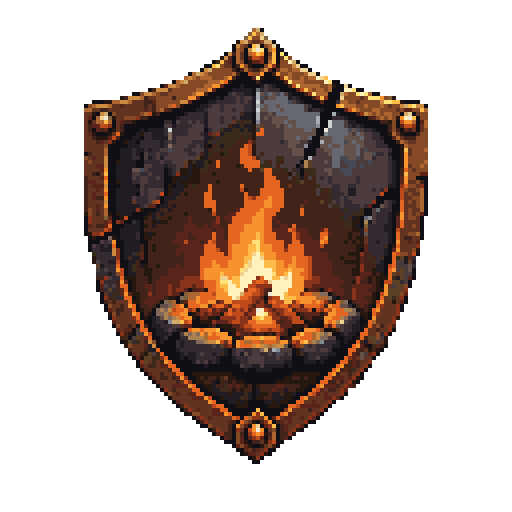
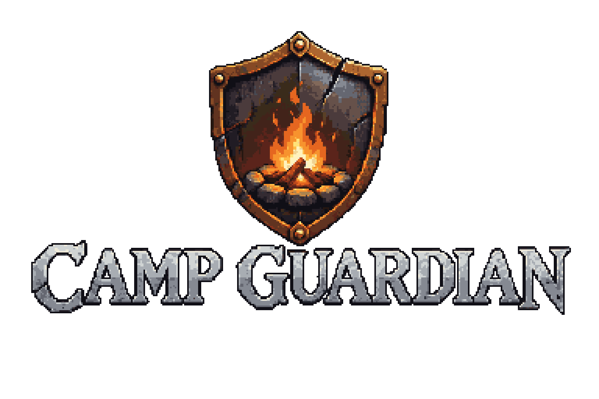
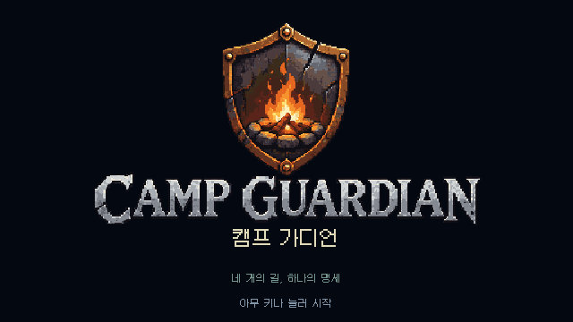

## 작업 결과

독립 로고 원본·출력 저장, README와 시작 화면 연결 완료. 사이트 프로젝트 아이콘 교체를 게시합니다.

## 변경 내용

### 적용 내용

기존 배너와 생성 원본은 보존했습니다. 심볼만 있는 투명 PNG는 프로젝트 아이콘, 영문 로고 투명 PNG는 README와 시작 화면에서 공유합니다. 게임 하단 제목은 기존 번역표를 사용하고 영문과 같으면 중복을 생략합니다. 내장 ImageGen 편집 프롬프트는 art/branding/logo-source.md에 보존했습니다. 다른 세션 변경은 커밋하지 않았습니다. 지침 변경 없음: 기존 원본 보존·정규화 규칙 적용.

추가 요청: 장작·방패·문자까지 33색 공통 팔레트와 4배 정수 격자로 도트 후처리했습니다. tools/postprocess-branding.mjs는 보존 원본을 읽어 논리384×256 로고와128×128 심볼을 만들고 최근접4배 출력합니다. 처리 설정과 해시는 art/branding/pixel-processing.json에 보존했습니다.

## 검증

PNG 외곽 알파0 및 투명 픽셀 수(영문 로고1254644, 심볼935810)를 확인했습니다. 지정 PNG만 정규화하고 해시를 기록했습니다. 실제 Godot 4.7.2에서 한국어·영어·일본어 화면을 렌더링하고 번역 제목과 영문 중복 생략을 확인했습니다. 임포트·캡처 종료코드0, 종료 시 기존 텍스처 해제 경고가 있습니다. 테스트는 미실행입니다.

후처리 출력의 장작·금속·문자 격자와 팔레트 및 최종 Godot 한국어 시작 화면을 확인했습니다. 기존 비도트 투명 출력은 생성 원본으로 보존했습니다.

## 남은 사항

EXE 재빌드는 미실행입니다. GitHub 푸시·사이트 배포·HTTPS 접근 결과는 최종 응답 참조.

## 작업 시간

- 제안 시간: 번역 분리 시작2026-11-17 21:13:28 KST, 5~7분. 독립 로고 추가 요청21:16 KST, 5~7분. 도트 후처리 추가 요청21:21 KST.
- 실제로 완료된 시간: 2026-11-17 21:22 KST 도트 후처리·파일 저장·Godot 렌더링 완료. 최종 게시 시간은 최종 응답 참조.
- XERJ: 미사용 — rg와 기존 번역표·PNG 알파·실제 Godot 렌더링으로 확인했습니다.
