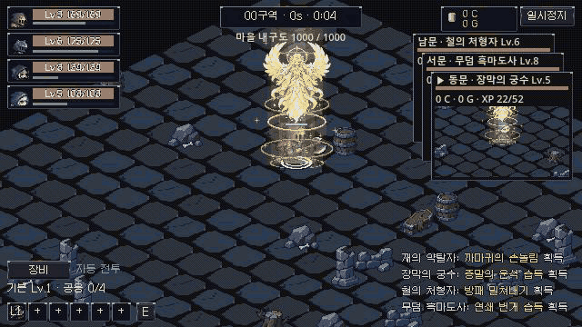

## 작업 결과

사운드 제작·연결·Godot 임포트·실제 전투/결과 렌더 및 출력 확인 완료. 게임 배포 빌드·사용자 청감 승인은 미확인입니다.

## 변경 내용

### 적용 내용

286×82 작은 결과 카드와1.22초 순서를 유지합니다. result_levelup_fx.gd에서 기존 정규화된 PixelFX augment_levelup/icon_gold를 재사용해 초상 주변 금빛 상승 고리·별빛·반짝임·테두리·게이지 광선과 레벨 업 문구를 표시합니다. 레벨 경계를 실제 성장 곡선으로 계산해0.16초 이상 간격으로 짧은 소리/폭발을 표시하고 마지막 도달 레벨에는 더 큰 별빛과 전용 팡파르를 연결했습니다. 레벨이 오르지 않은 결과에는 팡파르를 지급하지 않습니다. 약한 연출은 움직이는 입자/광선을 빼고 얇은 테두리/문구로 표시합니다. 전투 중 여신 축복은 기존 원본/타이밍을 유지하고 같은 금빛 고리와 새 레벨업음을 더했습니다. tools/audio/generate_levelup_feedback.py로0.72초 상승3음/화음/공기/부드러운 충격 팡파르와0.13초 짧은 레벨 악센트를 각3변형 합성했습니다. audio/source/levelup-feedback에 의도·1차/2차24bit 마스터·지표를 보존합니다. PixelFX 라이선스/원본과 기존 음향 원본을 유지하며 디자인 기준 내 변경으로 지침 추가 없음.

## 검증

48kHz PCM WAV6종,유한값/양끝0,true peak 팡파르 약-5.2dBTP·짧은 음 약-14.9dBTP. sound listen.py로1차/2차 파형·스펙트럼·음량을 확인했습니다. 0.13초 파일의--curve는 도구 STFT 길이 제약으로 실패해,전체 파일의 파형/지표 검사를--curve 없이 완료했습니다. 실제 Godot4.7.2/GTX970/OpenGL/640×360/30FPS/357프레임 렌더. RESULT_AUDIO levelups=4 level_ticks=10 fills=4 rewards=0 fanfare=1 locked=false errors=[] 확인. tree_paused=true에서level_up_1.wav playing=true,stream_paused=false,can_process=true. 실제 전투의 여신·금빛 기둥/고리와 결과 카드의 금빛 테두리·별빛·레벨업 문구를 확인했습니다. 녹화는 임시 저장 사용. 자동 테스트 미실행.

[소리 포함 실제 전투·결과 영상](../assets/levelup-feedback/20261117-levelup-feedback.mp4)

## 남은 사항

사용자 청감/연출 체감 승인과 모든 클래스 조합은 미확인입니다. 기존 user:// 로그·캐시 접근 및 종료 텍스처3개 해제 경고가 남습니다. 게임 배포 빌드 미실행. 중앙 푸시·웹 배포는 별도 확인합니다.

## 작업 시간

- 제안 시간: 2026-11-17 21:27:31 KST 시작,5~10분 내 제작·연결·실제 출력 확인.
- 실제로 완료된 시간: 제작·연결·Godot 임포트·실제 렌더/음향 확인·MP4/GIF 저장 2026-11-17 21:31:44 KST 완료,실측4분13초. 중앙 등록 시간 별도.
- XERJ: 미사용 — rg·관련 소스·음향 지표·실제 Godot 재생 로그/렌더 확인.
