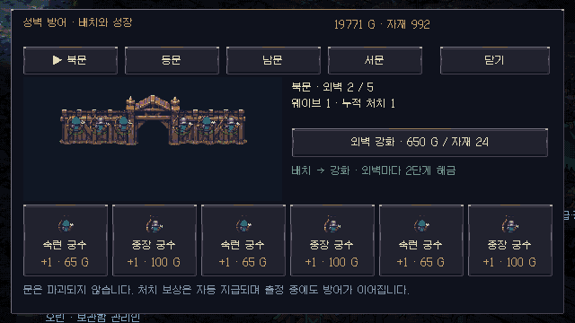
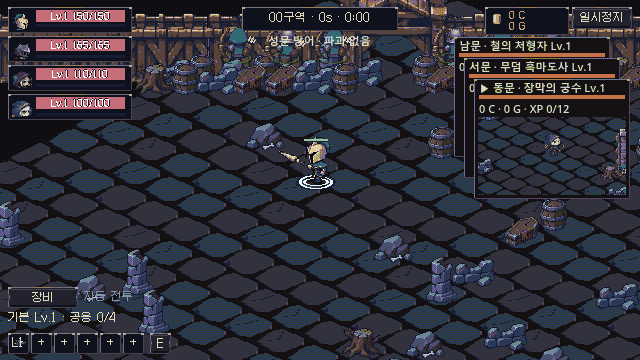

## 작업 결과

구현·원본 보존·파생80개 정규화·Godot 임포트·실제 OpenGL 렌더·배치/강화/외벽 구매 및 저장 재로딩 확인 완료. 고정 방어 병력의 공격이 실제 전투 적 체력을 깎고 대장·부하의 동일 대상 처치도 방어 웨이브 진행에 반영됩니다. 게임 실행파일 내보내기·설치·게임 저장소 푸시는 수행하지 않았습니다.

## 변경 내용

### 적용 내용

외벽20/연결 벽20/유닛40종 출력을 별도 생성·정규화했습니다. 각 방향6칸/총24칸, 외벽별 유닛2단계씩 해금, 골드와 자재 결제 및 결과를 한 저장으로 확정합니다. 출정 중에도 같은 병력이 실제 적에게 관통·범위 공격을 가하며 방향별 웨이브는 완전 처치 후 상승합니다. 마을/출정 전환 시 생존 적 체력을 보존하고 보상·웨이브를 함께 저장합니다. 기존 마을 파괴·중앙 도착 시 적 즉사 규칙을 제거했습니다. 시작 방어용 궁수1명씩 총4명을 제공합니다. 기존 대장 원정10구역과 독립된 영구 방어 웨이브입니다. 기존 사용자 변경은 보존했습니다. 생성 사양/원본 해시/추출 영역/발사 소켓 및 제작 절차를 기록했으며 기존 공통 규칙 변경은 없습니다.

## 검증

Godot 4.7.2 실제 GTX970 OpenGL 실행 종료0. 배치·병력 강화·외벽 구매 모두true. 실제 방어 병력 피해1163.6007, 실제 적 연결1301 actor-frame, 각방향6칸/4방향, 저장 재로딩 정상. 캡처 전용 임시 저장으로 운영 저장을 건드리지 않았습니다. 보상60 G, 북/남 방어 웨이브2 진입을 저장에서 확인했습니다. 실제 렌더30프레임 GIF 및 배치 UI 저장. 용어 검사210파일 금지어0건. 별도 테스트·전체 회귀는 수행하지 않았습니다. 첫 headless 캡처는 더미 렌더러여서 이미지 저장에 실패했으며 실제 OpenGL 실행으로 대체했습니다. 실행 종료 시 기존 텍스처3개 해제 경고와 user:// 셰이더 캐시 경고가 남았습니다.

## 남은 사항

장기 방어 난이도·실제 청감·모든 단계 조합의 장시간 동작은 미확인. 오프라인 보상은 구현 범위에 포함하지 않았습니다. 고정 병력은 정지 원본/후퇴/실제 투사체 방식이며 플레이어40자세 리그로 제작한 신규 애니메이션이 아닙니다. 중앙 아카이브 등록·커밋·푸시·배포·HTTPS 확인은 이 로컬 보고서 작성 시점 미진행입니다.

## 작업 시간

- 제안 시간: 2026-11-17 22:04:53 KST 시작, 전체 구현·자산·실제 렌더 확인20~30분 예상.
- 실제로 완료된 시간: 구현·저장·임포트·실행·렌더 확인 및 GIF 저장: 2026-11-17 22:23:15 KST, 실측18분22초. 보고서·아카이브 작업 시간은 이후 별도 기록합니다.
- XERJ: 미사용 — rg와 로컬 소스·설정·실제 실행 로그로 확인했습니다.
