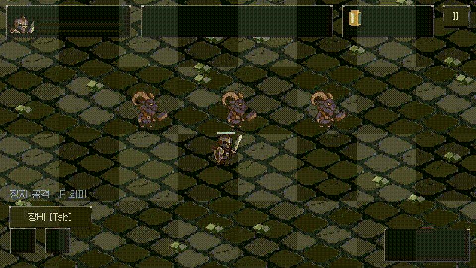

## 작업 결과

당시 세션의 결과 보고를 복원했습니다. 아래 기록은 해당 작업 시점의 결과이며 최신 버전 재검증을 뜻하지 않습니다.

## 변경 내용

### 적용 내용

속성 피해와 사망 연출을 구현했습니다.

- **냉기:** 얼음으로 굳은 뒤 몸체가 파편으로 깨집니다. 빙결 중에는 물리 막타도 적용됩니다.
- **화염:** 아래부터 타들어가며 불씨와 재로 사라집니다.
- **번개:** 감전으로 번쩍인 뒤 소멸합니다.

스킬·투사체·지속 피해에 속성을 연결했고, 최신 패키지에서 관련 **13항목 통과**했습니다.

최신 실행파일 ZIP (당시 로컬 자료; 공개 첨부 미확인)

예상 10분 / 실제 **9분 43초**, 09:57 KST 구현·빌드·확인 완료. 기획서와 지침도 갱신했습니다. 장기 밸런스는 미확인입니다.

## 검증

당시 세션 최종 보고에 명시된 검증 범위만 기록했습니다. 이번 등록에서는 게임 실행·청감·밸런스를 재검증하지 않았습니다.

## 남은 사항

현재 버전 동작은 미확인입니다. 기존 기록의 미확인·경고·후속 수정은 적용 내용에 보존했습니다. 원본 세션 전체 로그는 공개하지 않았습니다.

## 작업 시간

- 제안 시간: 당시 보고의 제안 시간 참조. 없으면 미기록.
- 실제로 완료된 시간: 당시 세션 종료: 2026-11-17T00:57:44.611Z / 세션 턴 실측 603초. 보고서 복원: 2026-11-17T07:40:29.644Z
- XERJ: 미사용 — 코드 검색 근거가 제공되지 않았습니다.
