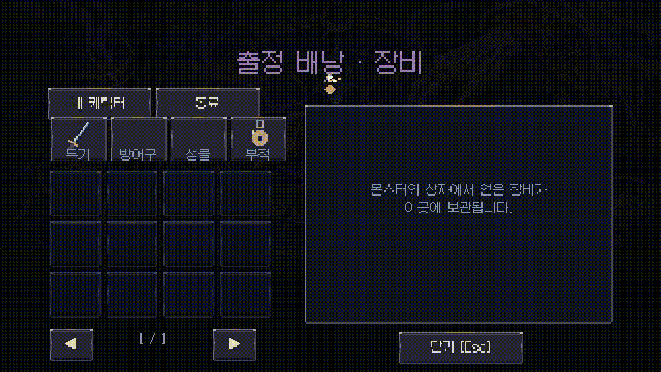

## 작업 결과

당시 세션의 결과 보고를 복원했습니다. 아래 기록은 해당 작업 시점의 결과이며 최신 버전 재검증을 뜻하지 않습니다.

## 변경 내용

### 적용 내용

슬롯 전용 부적 **6종과 전용 장착 칸 1개**를 추가했습니다.

| 부적 | 효과 |
|---|---|
| 재 속의 네잎 | 희귀 +6%p, 전설 +2%p |
| 거지왕의 동전 | 일반 당첨 시 코인 +35 |
| 애도의 종 | 희귀 당첨 시 체력 25% 회복 |
| 검은 계약 | 전설 당첨 시 에픽 무기 추가 |
| 금 간 주사위 | 일반 당첨 시 천장 +1 추가 |
| 운명의 눈 | 희귀·전설 확률 증가, 전설 시 골드 +20 |

상인 구매·몬스터 드롭으로 획득하고 인벤토리에서 장착합니다. 보너스는 **보상 수령 시 한 번만** 적용됩니다.

최신 실행파일 ZIP (당시 로컬 자료; 공개 첨부 미확인)

패키지 검사 **30항목 통과**, 기획서·지침 갱신 완료입니다. 예상 10분 / 실제 약 **9분 35초**, 10:07 KST 완료. 장기 밸런스는 미확인입니다.

## 검증

당시 세션 최종 보고에 명시된 검증 범위만 기록했습니다. 이번 등록에서는 게임 실행·청감·밸런스를 재검증하지 않았습니다.

## 남은 사항

현재 버전 동작은 미확인입니다. 기존 기록의 미확인·경고·후속 수정은 적용 내용에 보존했습니다. 원본 세션 전체 로그는 공개하지 않았습니다.

## 작업 시간

- 제안 시간: 당시 보고의 제안 시간 참조. 없으면 미기록.
- 실제로 완료된 시간: 당시 세션 종료: 2026-11-17T01:07:43.651Z / 세션 턴 실측 599초. 보고서 복원: 2026-11-17T07:40:29.648Z
- XERJ: 미사용 — 코드 검색 근거가 제공되지 않았습니다.
