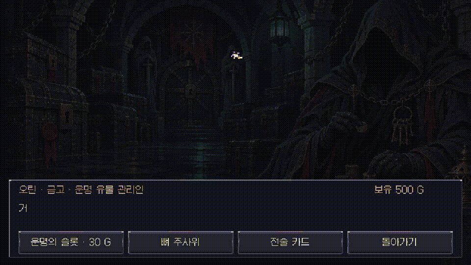

## 작업 결과

당시 세션의 결과 보고를 복원했습니다. 아래 기록은 해당 작업 시점의 결과이며 최신 버전 재검증을 뜻하지 않습니다.

## 변경 내용

### 적용 내용

변경했습니다. **전투 중 운명의 선택은 증강만 등장**하며, 나머지는 마을 NPC로 옮겼습니다.

- **바론:** 장비 강화·장비 도박
- **세라:** 천사의 손길·악마와 거래
- **로웬:** 스킬 수련·현상금·수집 의뢰
- **미라:** 장비·부적·동료 영입
- **오린:** 슬롯·주사위·카드·보관함

슬롯 부적도 마을에서 장착해 적용합니다. 기획서·지침과 최신 빌드를 갱신했고, 관련 기능 확인을 통과했습니다.

최신 실행파일 ZIP (당시 로컬 자료; 공개 첨부 미확인)

예상 10분 → 실제 약 **11분 30초**, 10:19 KST 완료. 장기 밸런스는 미확인입니다.

## 검증

당시 세션 최종 보고에 명시된 검증 범위만 기록했습니다. 이번 등록에서는 게임 실행·청감·밸런스를 재검증하지 않았습니다.

## 남은 사항

현재 버전 동작은 미확인입니다. 기존 기록의 미확인·경고·후속 수정은 적용 내용에 보존했습니다. 원본 세션 전체 로그는 공개하지 않았습니다.

## 작업 시간

- 제안 시간: 당시 보고의 제안 시간 참조. 없으면 미기록.
- 실제로 완료된 시간: 당시 세션 종료: 2026-11-17T01:19:33.837Z / 세션 턴 실측 710초. 보고서 복원: 2026-11-17T07:40:29.653Z
- XERJ: 미사용 — 코드 검색 근거가 제공되지 않았습니다.
