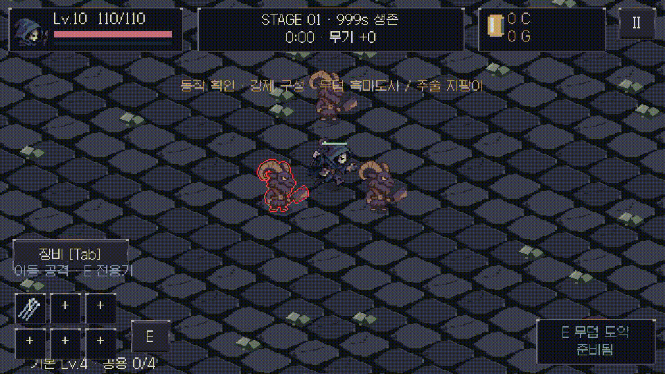

## 작업 결과

당시 세션의 결과 보고를 복원했습니다. 아래 기록은 해당 작업 시점의 결과이며 최신 버전 재검증을 뜻하지 않습니다.

## 변경 내용

### 적용 내용

캐릭터 재제작과 이동 공격을 반영했습니다.

- **8시트·각 12자세:** 배경 잔여물 제거, 크기·발 기준 통일, 픽셀 정규화
- **이동하면서 자동 공격**, 클래스별 기본 공격 성장 추가
- **E 전용기:** 전사 돌진, 궁수 장거리 회피, 마법사 텔레포트, 처형자 돌파, 암살자 질주
- **공용 스킬 8종:** 증강으로 습득·강화하며 최대 4종 장착

[전사 GIF](../assets/history/01a1e716-84f5-7991-ba55-b19a122d0864-20261117-knight-moving.gif) · [궁수 GIF](../assets/history/01a1e716-84f5-7991-ba55-b19a122d0864-20261117-archer-evade.gif) · 최신 실행파일 ZIP (당시 로컬 자료; 공개 첨부 미확인)

기획서·지침도 갱신했습니다. 실제 GPU 녹화와 내보낸 EXE에서 동작을 확인했으며, 장기 밸런스·청감은 미확인입니다.

예상 **25~35분** / 실제 **34분 28초**, **10:54 KST 완료**.

## 검증

당시 세션 최종 보고에 명시된 검증 범위만 기록했습니다. 이번 등록에서는 게임 실행·청감·밸런스를 재검증하지 않았습니다.

## 남은 사항

현재 버전 동작은 미확인입니다. 기존 기록의 미확인·경고·후속 수정은 적용 내용에 보존했습니다. 원본 세션 전체 로그는 공개하지 않았습니다.

## 작업 시간

- 제안 시간: 당시 보고의 제안 시간 참조. 없으면 미기록.
- 실제로 완료된 시간: 당시 세션 종료: 2026-11-17T01:54:33.668Z / 세션 턴 실측 2098초. 보고서 복원: 2026-11-17T07:40:29.671Z
- XERJ: 미사용 — 코드 검색 근거가 제공되지 않았습니다.
