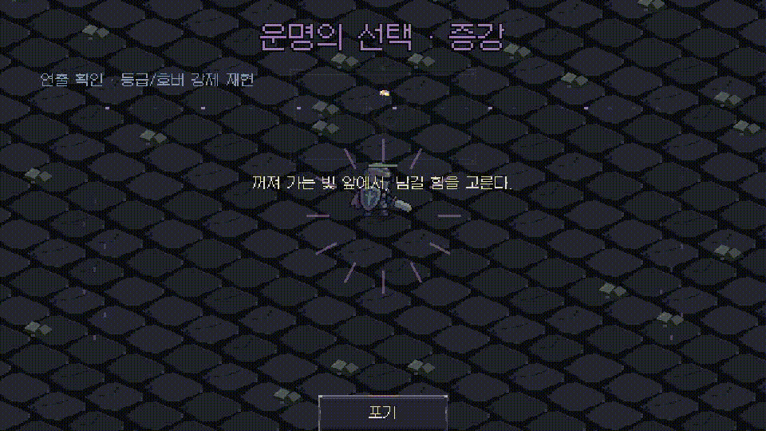

## 작업 결과

당시 세션의 결과 보고를 복원했습니다. 아래 기록은 해당 작업 시점의 결과이며 최신 버전 재검증을 뜻하지 않습니다.

## 변경 내용

### 적용 내용

반영했습니다.

- 부분 일러스트를 **작은 도트 프레임** 안에 배치
- 카드 일러스트 **21장** 제작·연결
- 일반·희귀·전설별 **광택·테두리 반짝임·호버 별빛** 추가
- 손패에도 일러스트 적용, 설명과 그림 분리

[손패 GIF](../assets/history/01a1e736-90f4-7591-b365-a3b504362ea4-20261117-foil-hand.gif) · 최신 실행파일 ZIP (당시 로컬 자료; 공개 첨부 미확인)

구현·빌드·실제 렌더링 확인, 기획서·지침 갱신 완료입니다. 예상 **15~20분** / 실제 **16분 34초**, **11:11 KST 완료**.

## 검증

당시 세션 최종 보고에 명시된 검증 범위만 기록했습니다. 이번 등록에서는 게임 실행·청감·밸런스를 재검증하지 않았습니다.

## 남은 사항

현재 버전 동작은 미확인입니다. 기존 기록의 미확인·경고·후속 수정은 적용 내용에 보존했습니다. 원본 세션 전체 로그는 공개하지 않았습니다.

## 작업 시간

- 제안 시간: 당시 보고의 제안 시간 참조. 없으면 미기록.
- 실제로 완료된 시간: 당시 세션 종료: 2026-11-17T02:11:32.361Z / 세션 턴 실측 1017초. 보고서 복원: 2026-11-17T07:40:29.675Z
- XERJ: 미사용 — 코드 검색 근거가 제공되지 않았습니다.
