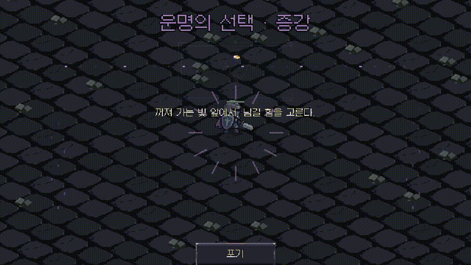

## 작업 결과

당시 세션의 결과 보고를 복원했습니다. 아래 기록은 해당 작업 시점의 결과이며 최신 버전 재검증을 뜻하지 않습니다.

## 변경 내용

### 적용 내용

반영했습니다.

- 카드 일러스트 제거 → **아이콘·금속 프레임 중심**으로 변경
- 선택 카드는 앞으로 확대·발광, 나머지는 **불타서 소멸**
- 선택·점화·보상 효과음 **6개** 연결
- 마을 NPC 흔들림 수정, **캐스팅 고정 자세 제거**

[사운드 포함 영상](../assets/history/01a1e75b-21b3-71c0-a834-1c68bf4e1897-20261117-premium-card-choice.mp4) · [NPC 이동 확인](../assets/history/01a1e75b-21b3-71c0-a834-1c68bf4e1897-20261117-town-camera-stable.gif) · 최신 ZIP (당시 로컬 자료; 공개 첨부 미확인)

구현·빌드·관련 실행 확인 완료입니다. 실제 청감은 미확인입니다. 예상 **10분** / 추가 요청 포함 실제 **14분 22초**, **11:49 KST 완료**.

## 검증

당시 세션 최종 보고에 명시된 검증 범위만 기록했습니다. 이번 등록에서는 게임 실행·청감·밸런스를 재검증하지 않았습니다.

## 남은 사항

현재 버전 동작은 미확인입니다. 기존 기록의 미확인·경고·후속 수정은 적용 내용에 보존했습니다. 원본 세션 전체 로그는 공개하지 않았습니다.

## 작업 시간

- 제안 시간: 당시 보고의 제안 시간 참조. 없으면 미기록.
- 실제로 완료된 시간: 당시 세션 종료: 2026-11-17T02:49:12.791Z / 세션 턴 실측 881초. 보고서 복원: 2026-11-17T07:40:29.685Z
- XERJ: 미사용 — 코드 검색 근거가 제공되지 않았습니다.
