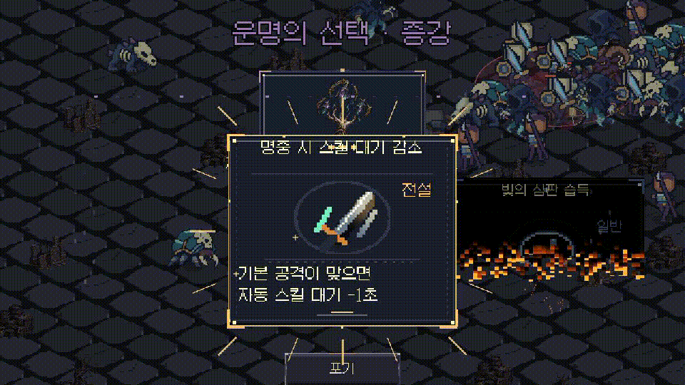

## 작업 결과

당시 세션의 결과 보고를 복원했습니다. 아래 기록은 해당 작업 시점의 결과이며 최신 버전 재검증을 뜻하지 않습니다.

## 변경 내용

### 적용 내용

전투를 **AI가 조종하고, 사용자는 증강만 선택**하도록 반영했습니다.

- 환영 무기·숨은 무한 누적 증강 제거, 효과·수치 설명 정리
- AI가 이동·공격·위험 회피·재화 회수·손패 사용
- 마을 클릭 이동 지원, 전투 클릭/WASD는 수동 개입
- 반복 연산 감소, 정적 잔해·이동 표시를 이미지로 처리
- 60마리 비교 장면 드로우콜 **약 31% 감소**, 60FPS 유지

[전체 확인 영상](../assets/history/01a1e78c-57ff-7563-a490-d22be3b1d193-20261117-auto-pilot.mp4) · 최신 ZIP (당시 로컬 자료; 공개 첨부 미확인)

구현·빌드·관련 실행 확인 완료. AI 보스전·장기 밸런스는 미확인입니다.  
예상 **15~20분＋추가 AI 작업** / 실제 **21분 11초**, **12:49 KST 완료**.

## 검증

당시 세션 최종 보고에 명시된 검증 범위만 기록했습니다. 이번 등록에서는 게임 실행·청감·밸런스를 재검증하지 않았습니다.

## 남은 사항

현재 버전 동작은 미확인입니다. 기존 기록의 미확인·경고·후속 수정은 적용 내용에 보존했습니다. 원본 세션 전체 로그는 공개하지 않았습니다.

## 작업 시간

- 제안 시간: 당시 보고의 제안 시간 참조. 없으면 미기록.
- 실제로 완료된 시간: 당시 세션 종료: 2026-11-17T03:50:07.470Z / 세션 턴 실측 1311초. 보고서 복원: 2026-11-17T07:40:29.707Z
- XERJ: 미사용 — 코드 검색 근거가 제공되지 않았습니다.
