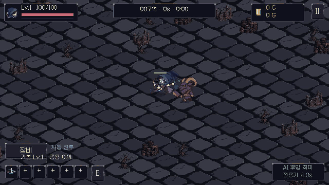
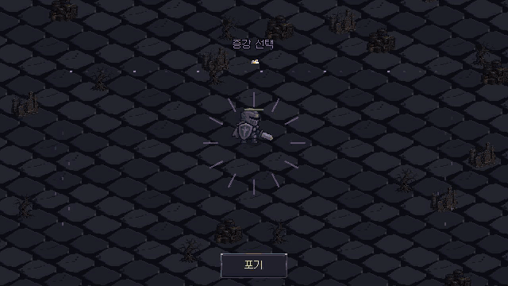

## 작업 결과

당시 세션의 결과 보고를 복원했습니다. 아래 기록은 해당 작업 시점의 결과이며 최신 버전 재검증을 뜻하지 않습니다.

## 변경 내용

### 적용 내용

반영하고 실행 파일까지 갱신했습니다.

- **HUD 축소:** 정보 글씨 10px, 스킬 슬롯·초상·손패 크기 축소
- **PixelFX:** 아이콘 등급별 반짝임·선택 효과, 마법사의 자주색 마법탄 적용
- **클래스 AI:** 궁수·마법사는 거리 유지와 근접 위협 회피 우선. 기사는 방패 교전, 처형자는 강타 거리, 암살자는 측면 이동으로 구분

실제 전투 렌더와 빌드를 확인했습니다. 장시간·보스전 밸런스는 미확인입니다.

실행 파일 (당시 로컬 자료; 공개 첨부 미확인)

예상 10분 / 실제 **7분 15초**, **13:10:34 KST 완료**.

## 검증

당시 세션 최종 보고에 명시된 검증 범위만 기록했습니다. 이번 등록에서는 게임 실행·청감·밸런스를 재검증하지 않았습니다.

## 남은 사항

현재 버전 동작은 미확인입니다. 기존 기록의 미확인·경고·후속 수정은 적용 내용에 보존했습니다. 원본 세션 전체 로그는 공개하지 않았습니다.

## 작업 시간

- 제안 시간: 당시 보고의 제안 시간 참조. 없으면 미기록.
- 실제로 완료된 시간: 당시 세션 종료: 2026-11-17T04:10:43.365Z / 세션 턴 실측 452초. 보고서 복원: 2026-11-17T07:40:29.730Z
- XERJ: 미사용 — 코드 검색 근거가 제공되지 않았습니다.
