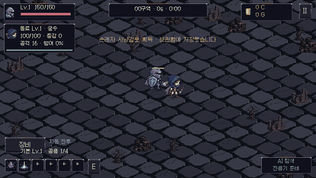
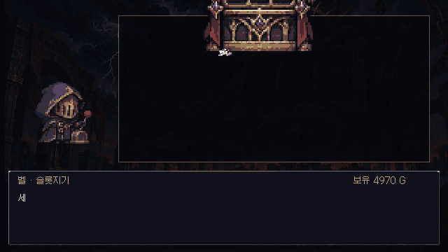
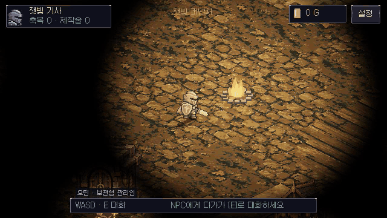

## 작업 결과

당시 세션의 결과 보고를 복원했습니다. 아래 기록은 해당 작업 시점의 결과이며 최신 버전 재검증을 뜻하지 않습니다.

## 변경 내용

### 적용 내용

구현하고 **0.8.0 실행 파일까지 갱신했습니다.**

- **동료 상태창:** 체력·공격력·방어·레벨·증강 수 표시
- **동료 자동 증강:** 레벨업마다 8종 중 자동 선택
- **카드 획득 연출:** 플레이어·동료 상태창 옆에 표시
- **마을 재구성:** NPC 14명으로 기능 분리, 구역별 바닥 8종과 새 시설 배치
- **카지노:** 슬롯·주사위·카드·강화·천사·악마·봉인 장비 전용 연출 적용

실제 실행에서 NPC 접근 경로와 결제·보상 저장, 동료 성장·공격력 증가를 확인했습니다. 장기 밸런스는 미확인입니다. 지침·기획서도 갱신했습니다.

새 실행 파일 (당시 로컬 자료; 공개 첨부 미확인)로 다시 실행해 주세요.

예상 20~25분 / 실제 **19분 28초**, **13:30:21 KST 완료**.

## 검증

당시 세션 최종 보고에 명시된 검증 범위만 기록했습니다. 이번 등록에서는 게임 실행·청감·밸런스를 재검증하지 않았습니다.

## 남은 사항

현재 버전 동작은 미확인입니다. 기존 기록의 미확인·경고·후속 수정은 적용 내용에 보존했습니다. 원본 세션 전체 로그는 공개하지 않았습니다.

## 작업 시간

- 제안 시간: 당시 보고의 제안 시간 참조. 없으면 미기록.
- 실제로 완료된 시간: 당시 세션 종료: 2026-11-17T04:30:32.086Z / 세션 턴 실측 1187초. 보고서 복원: 2026-11-17T07:40:29.740Z
- XERJ: 미사용 — 코드 검색 근거가 제공되지 않았습니다.
