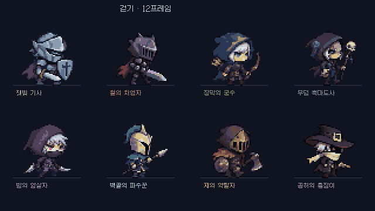

## 작업 결과

당시 세션의 결과 보고를 복원했습니다. 아래 기록은 해당 작업 시점의 결과이며 최신 버전 재검증을 뜻하지 않습니다.

## 변경 내용

### 적용 내용

**플레이어 8클래스의 모션을 교체하고 0.9.0 빌드를 갱신했습니다.**

- 클래스마다 걷기 12·공격 12·이동 공격 12프레임 등 **총 40자세**, 전체 320자세
- 한손검·특대검의 준비→휘두름→반동→회수와 타격·PixelFX 시점 재구성
- 장창·도끼·총은 외형이 다른 독립 클래스로 분리
- 저장 재로드·장비 교체·증강 이후에도 클래스와 무기가 유지되는지 확인

기획·제작 지침도 갱신했습니다. 장기 전투 밸런스는 미확인입니다.

새 실행 파일 (당시 로컬 자료; 공개 첨부 미확인)

예상 25~30분 / 실제 **23분 16초**, **14:00:51 KST 완료**.

## 검증

당시 세션 최종 보고에 명시된 검증 범위만 기록했습니다. 이번 등록에서는 게임 실행·청감·밸런스를 재검증하지 않았습니다.

## 남은 사항

현재 버전 동작은 미확인입니다. 기존 기록의 미확인·경고·후속 수정은 적용 내용에 보존했습니다. 원본 세션 전체 로그는 공개하지 않았습니다.

## 작업 시간

- 제안 시간: 당시 보고의 제안 시간 참조. 없으면 미기록.
- 실제로 완료된 시간: 당시 세션 종료: 2026-11-17T05:01:40.643Z / 세션 턴 실측 1455초. 보고서 복원: 2026-11-17T07:40:29.749Z
- XERJ: 미사용 — 코드 검색 근거가 제공되지 않았습니다.
