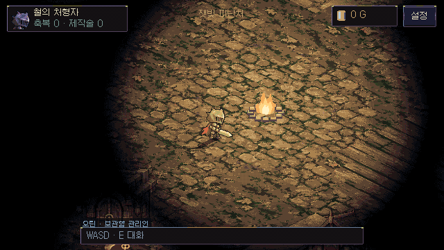

## 작업 결과

당시 세션의 결과 보고를 복원했습니다. 아래 기록은 해당 작업 시점의 결과이며 최신 버전 재검증을 뜻하지 않습니다.

## 변경 내용

### 적용 내용

전체 화면에 **48색 제한 + 바둑판 망점 디더링**을 적용했습니다.

- 캐릭터·지형·조명·FX·UI에 공통 적용
- 640×360 렌더링·정수 확대로 도트 크기 통일
- 원본 보존, 아트 기준 갱신
- Godot 실행 확인 완료. 캐시·종료 리소스 경고는 남았습니다.

영상 전체는 접근 불가로 **미확인**이며, 첨부 화면을 기준으로 구현했습니다. 빌드·배포는 하지 않았습니다.

제안 시간: 8~10분 · 실제: **4분 16초**, 13:56:46 KST 완료.

## 검증

당시 세션 최종 보고에 명시된 검증 범위만 기록했습니다. 이번 등록에서는 게임 실행·청감·밸런스를 재검증하지 않았습니다.

## 남은 사항

현재 버전 동작은 미확인입니다. 기존 기록의 미확인·경고·후속 수정은 적용 내용에 보존했습니다. 원본 세션 전체 로그는 공개하지 않았습니다.

## 작업 시간

- 제안 시간: 당시 보고의 제안 시간 참조. 없으면 미기록.
- 실제로 완료된 시간: 당시 세션 종료: 2026-11-17T04:56:55.000Z / 세션 턴 실측 273초. 보고서 복원: 2026-11-17T07:40:29.788Z
- XERJ: 미사용 — 코드 검색 근거가 제공되지 않았습니다.
