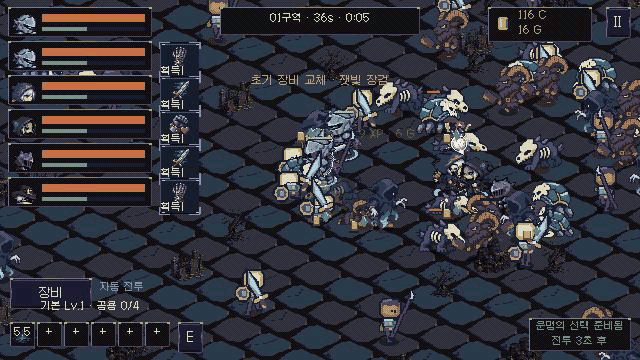

## 작업 결과

당시 세션의 결과 보고를 복원했습니다. 아래 기록은 해당 작업 시점의 결과이며 최신 버전 재검증을 뜻하지 않습니다.

## 변경 내용

### 적용 내용

**동료 최대 5명 편성과 역할별 AI를 구현했습니다.**

- 동료 8종 중 용병 계약관에서 영입·편성
- 호위·원거리 사격·근접 교전·치유 등 역할 구분
- 동료마다 독립 증강·장비 관리, 사망 시 해당 장비만 회수
- 플레이어 AI에 반응 지연·판단 편차·공격 집중 시간을 적용

확인용 단독 전투에서는 약 50초 동안 **11회 피격**했습니다. 5인 전투와 편성 제한·장비 회수도 확인했습니다. 장기·보스전 밸런스는 미확인입니다.

새 실행 파일 (당시 로컬 자료; 공개 첨부 미확인)

예상 25~30분 / 실제 **22분 11초**, **14:27:19 KST 완료**.

## 검증

당시 세션 최종 보고에 명시된 검증 범위만 기록했습니다. 이번 등록에서는 게임 실행·청감·밸런스를 재검증하지 않았습니다.

## 남은 사항

현재 버전 동작은 미확인입니다. 기존 기록의 미확인·경고·후속 수정은 적용 내용에 보존했습니다. 원본 세션 전체 로그는 공개하지 않았습니다.

## 작업 시간

- 제안 시간: 당시 보고의 제안 시간 참조. 없으면 미기록.
- 실제로 완료된 시간: 당시 세션 종료: 2026-11-17T05:27:46.000Z / 세션 턴 실측 1367초. 보고서 복원: 2026-11-17T07:40:29.599Z
- XERJ: 미사용 — 코드 검색 근거가 제공되지 않았습니다.
