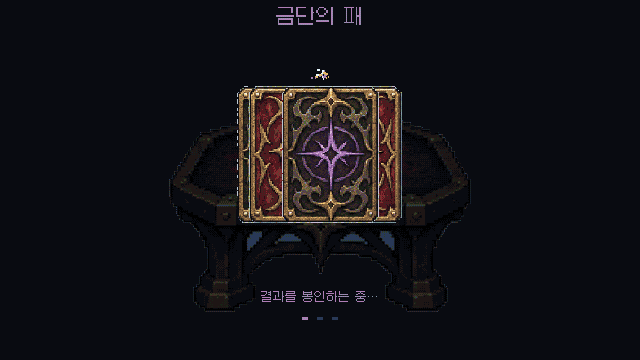

## 작업 결과

당시 세션의 결과 보고를 복원했습니다. 아래 기록은 해당 작업 시점의 결과이며 최신 버전 재검증을 뜻하지 않습니다.

## 변경 내용

### 적용 내용

**카드·강화·천사·악마·상자까지 모두 새로 그려 교체했습니다.**

- 슬롯 본체·소품 16종·심볼 6종 재제작
- 비율 왜곡과 원본보다 큰 확대 제거
- **3×3 슬롯, 가로·세로·대각선 8줄 빙고** 및 줄별 혜택 합산
- 실제 군량 빙고의 **추가 40 C 지급·저장 확인**

아래는 나머지 5종부터 보여주는 실제 Godot 영상입니다.

제안: 약 10분 · 실제 **9분 57초**, **14:17:57 KST 완료**. 구현·실행 확인 완료, 빌드·배포 없음. 청감은 미확인입니다.

## 검증

당시 세션 최종 보고에 명시된 검증 범위만 기록했습니다. 이번 등록에서는 게임 실행·청감·밸런스를 재검증하지 않았습니다.

## 남은 사항

현재 버전 동작은 미확인입니다. 기존 기록의 미확인·경고·후속 수정은 적용 내용에 보존했습니다. 원본 세션 전체 로그는 공개하지 않았습니다.

## 작업 시간

- 제안 시간: 당시 보고의 제안 시간 참조. 없으면 미기록.
- 실제로 완료된 시간: 당시 세션 종료: 2026-11-17T05:18:10.000Z / 세션 턴 실측 618초. 보고서 복원: 2026-11-17T07:40:29.780Z
- XERJ: 미사용 — 코드 검색 근거가 제공되지 않았습니다.
