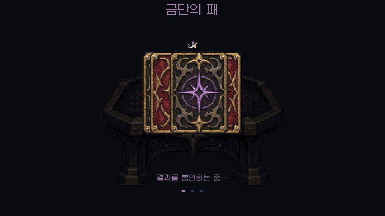

## 작업 결과

당시 세션의 결과 보고를 복원했습니다. 아래 기록은 해당 작업 시점의 결과이며 최신 버전 재검증을 뜻하지 않습니다.

## 변경 내용

### 적용 내용

**카지노 소품 16종·심볼 6종 전체의 흰 테두리와 배경 잔여 픽셀을 수정했습니다.** 재생성보다 추출 과정의 배경 제거가 핵심이었습니다.

- 바깥 윤곽과 날개 안쪽 등 닫힌 틈까지 정리
- 뼈·금속 내부 하이라이트와 의도된 FX는 보존
- 7개 서비스의 실제 Godot 화면 확인 완료

제안: 5~8분 · 실제 **4분 36초**, **14:24:53 KST 완료**. 빌드·배포는 하지 않았습니다.

## 검증

당시 세션 최종 보고에 명시된 검증 범위만 기록했습니다. 이번 등록에서는 게임 실행·청감·밸런스를 재검증하지 않았습니다.

## 남은 사항

현재 버전 동작은 미확인입니다. 기존 기록의 미확인·경고·후속 수정은 적용 내용에 보존했습니다. 원본 세션 전체 로그는 공개하지 않았습니다.

## 작업 시간

- 제안 시간: 당시 보고의 제안 시간 참조. 없으면 미기록.
- 실제로 완료된 시간: 당시 세션 종료: 2026-11-17T05:25:06.000Z / 세션 턴 실측 296초. 보고서 복원: 2026-11-17T07:40:29.774Z
- XERJ: 미사용 — 코드 검색 근거가 제공되지 않았습니다.
