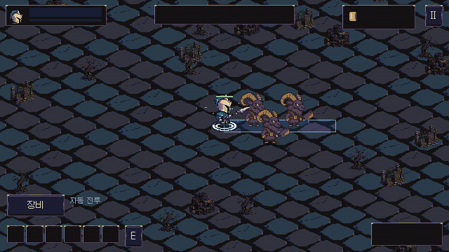

## 작업 결과

당시 세션의 결과 보고를 복원했습니다. 아래 기록은 해당 작업 시점의 결과이며 최신 버전 재검증을 뜻하지 않습니다.

## 변경 내용

### 적용 내용

창 기사 E 전용기 **‘백골 돌격’**을 추가했습니다.

- **0.65초 충전 → 고정 방향 직선 돌진**
- 경로의 적에게 공격력 **280% 피해·넉백**, 대상마다 1회 타격
- 청색 경로·충전 표시·잔상 적용
- 벽에서 정지, 강한 상태이상으로 충전 취소
- 재사용 **7초**

저장·임포트·실제 Godot 실행 확인 완료했습니다. 체감 밸런스와 청감은 미확인입니다.

제안 7분 / 실제 **4분 37초**, **14:29:47 KST 완료**.

## 검증

당시 세션 최종 보고에 명시된 검증 범위만 기록했습니다. 이번 등록에서는 게임 실행·청감·밸런스를 재검증하지 않았습니다.

## 남은 사항

현재 버전 동작은 미확인입니다. 기존 기록의 미확인·경고·후속 수정은 적용 내용에 보존했습니다. 원본 세션 전체 로그는 공개하지 않았습니다.

## 작업 시간

- 제안 시간: 당시 보고의 제안 시간 참조. 없으면 미기록.
- 실제로 완료된 시간: 당시 세션 종료: 2026-11-17T05:29:56.000Z / 세션 턴 실측 295초. 보고서 복원: 2026-11-17T07:40:29.755Z
- XERJ: 미사용 — 코드 검색 근거가 제공되지 않았습니다.
